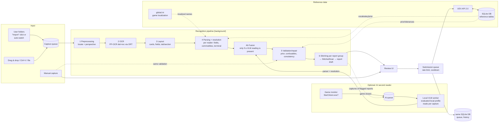

# System architecture

> **Doc type:** Living spec — binding. Last reviewed: 2026-11-07.

> Amended 2026-10-12 (ADR-0005): the implementation language is Rust with egui, native code only by registered exception. The context cut, the ports, the data flow and all behavioural rules of this document are unchanged; §2, §3, §4a, §4b, §7, §8, §9 (wording) and §10 name the Rust technology instead of Java, JavaFX and Gradle. Crates, versions and tools not named in ADR-0005 are chosen and verified at source in M0.

## 1. Overview



Guiding principles:

1. **UEX data is a constraint, not decoration.** Every recognition is resolved against the closed vocabulary (terminals, commodities, status levels, container sizes). Free OCR strings never reach the API.
2. **Guess nothing silently.** Every uncertainty becomes visible as a warning with a reason code. The submission gate blocks anything unresolved.
3. **Pure domain logic and I/O are separated.** Pipeline stages are pure functions on immutable records. This makes them testable with golden data, without UI and without network.
4. **Language-neutral cut.** The module boundaries allow individual parts (e.g. the OCR core) to be replaced later.

## 2. Modules (Cargo workspace, one crate per context) – bounded contexts + ports & adapters

Implementation 2026-11-01 (R-API-4, R-API-7, R-NF-4): `submission` owns `CredentialApplication`, `CredentialValidator` and `SecretStore`. A candidate validates before the application saves one complete record and publishes its username. Corrected 2026-11-02: failed replacements preserve the previously accepted in-memory record; a dispatched storage mutation with a lost result returns `OutcomeUnknown` and requires a later load before retry. Request generations reject superseded results. Current-identity refusals persist independently of availability failures, and session-only credentials retain that lifetime through revalidation. The UEX adapter implements read-only validation with `/user` followed by username-filtered `data_info`; an empty report list succeeds. Only closed failure enums cross this boundary, including a distinct client-version-header failure. Secret-bearing credential values, candidates, saved records and validation requests do not implement `Debug`; safe account states and closed failures remain available for diagnostics. The application API accepts release-token installation data for a check without saving it in the credential record. Windows and Linux store support is described below; secure fallback and desktop wiring are implemented below; native onboarding acceptance remains pending, so this application slice does not complete issue #82.

Credential dependency foundation 2026-11-02: platform-specific dependencies select owned keyring-core/Windows store and injected asynchronous Secret Service/zbus, with exact native/source/target guards. Corrected 2026-11-02: the Windows adapter below implements the approved local credential calls; the Linux transport below enforces the approved local bus boundary; the Secret Service record adapter below adds encrypted storage; warned secure fallback and desktop onboarding are composed below; native acceptance remains pending. The dependency/authority evidence is "supply-chain/credential-adoption.json"; the existing data-flow inventory is not expanded by merely linking these libraries.

Linux credential transport 2026-11-02 (R-NF-4): `LinuxCredentialBus` owns an asynchronous bus connection on the caller's Tokio runtime. It accepts one explicitly supplied filesystem Unix address, optionally with a GUID, and rejects other transports, alternative-address lists, unknown/duplicate options and malformed paths. Every path component must be free of symlinks; the direct parent must be a directory owned by the effective UID with no group/world access, and the endpoint must be a socket. After connecting, Tokio's Linux `peer_cred` verifies that same effective UID before any authentication bytes. Only that stream enters zbus with EXTERNAL authentication forced; a supplied GUID must match the authenticated server. Establishment has a five-second deadline and closed unavailable failures. This transport does not negotiate a Secret Service session, read or write a credential, create a keyring, unlock or prompt. The connection remains owned until dropped. Callers must suppress credential dependency logging targets before formatting or bridging. Corrected 2026-11-02: desktop composition invokes this transport on the credential worker with the filtered log bridge installed before workers start. Isolated temporary-socket protocol contracts are distinct from OS-provider acceptance.

Linux credential records 2026-11-02 (R-API-4, R-API-7, R-NF-4): `LinuxCredentialStore` consumes the checked bus and retains an injected asynchronous `secret-service` DH session, without falling back to Plain. It uses only the default collection and fixed application/record attributes, rejecting multiple matches before reading or changing a record. The explicit mutation contracts include committed replacement/removal with withheld replies, subsequent reconciliation and no automatic retry. Startup/load only reads lock properties and returns `Locked`; no collection is created or unlocked. Save atomically replaces one complete application bundle through the provider's replace operation; remove deletes only the unique matching item and succeeds when it is absent. Explicit save may execute a provider-requested protocol prompt; remove returns `Locked` if the provider requires a prompt and does not execute it. Refusal is a closed failure. Connection/load have a five-second deadline; mutation preflight and the dispatched request each have a separate five-second deadline. A timeout, broken connection or malformed reply after dispatch returns the distinct closed `StorageFailure::OutcomeUnknown`; the application retains its accepted in-memory state and a later load reconciles stored state before any retry. Read-only preflight failures remain distinct. No retry or alternate collection is selected automatically. The shared version-one codec bounds plaintext to 2560 bytes and erases adapter-owned encoded/decrypted buffers. The dependency receives a complete protocol reply before decoding; this is not a 2560-byte transport allocation bound. Library errors are never formatted; polling these operations suppresses tracing, and composition must also suppress credential dependency targets before formatting/bridging background events. Desktop composition now supplies the serial worker; actual OS-provider/prompt and native visual acceptance remain pending. The isolated socket fixture checks encrypted payload round-tripping within one negotiated session, not independent cryptographic vectors or cross-session provider persistence.

Windows credential adapter 2026-11-02 (R-API-4, R-API-7, R-NF-4): `WindowsCredentialStore` implements `SecretStore` using an owned Windows store and the fixed service/user pair `Tallyline` / `uex-credentials`. It explicitly requests `persistence=Local`, never the dependency default Enterprise or the global default store. Operations run on the serial application-owned credential worker. One non-empty versioned binary bundle is bounded to 2560 bytes and holds the key, optional own token, reduced account identity, precise validation timestamp and optional known account refusal. The release token is excluded. The private platform codec validates the version, lengths, UTF-8, printable credential inputs, account identity, timestamp, refusal and complete consumption before reconstructing the context record. Missing entries are distinct from corrupt, locked or unavailable stores; failed saves retain the previous record and accepted session lifetime. Temporary encoded/read buffers and dependency-owned bad-data byte payloads are erased before release. No raw provider error is formatted. Isolated provider contracts test these behaviours, including a literal protocol fixture; actual Windows OS-store acceptance and native visual acceptance remain pending.

Backend support 2026-11-01 (R-NF-4): `adapter-platform::ReleaseTokenFile` reads only `tallyline-app-token` in the injected executable directory. Reads are capped at 4 KiB plus one overflow byte; the token is bounded to 1 KiB printable ASCII after ASCII whitespace is trimmed. Missing or empty data returns the own-token setup state; malformed or unreadable data returns separate closed failures. The returned `submission::ReleaseToken` has no `Debug` implementation. This reader writes no installation data. Corrected 2026-11-02: desktop composition reads the packaged token on the credential worker before restoring or validating an account; the token is never persisted in an OS store.

The cut combines **DDD bounded contexts** with **ports & adapters** (decision and trade-offs: [ADR-0002](../adr/0002-modules-by-bounded-context.md), technology terms amended by [ADR-0005](../adr/0005-rust-and-egui.md)). Below, "module" means a Cargo workspace crate:

- **Core** = one crate per bounded context ([11 §A2](11-ddd-and-tdd.md)), plus `shared-kernel` and `workflows`.
  - Each context crate contains its domain model **and** its application services (use cases).
  - The core knows no technology: no egui, no image codecs, no HTTP or sockets, no SQL, no ONNX, no file system (`std::fs`, `std::net`, `std::process`), no native access or `unsafe` (`#![forbid(unsafe_code)]`), no clock except through an injected `Clock` trait (enforcement in 09 §2, ADR-0005 D13).
  - Images enter the core as an own immutable raster type (`ImageRaster`: width, height, ARGB `u32` pixels), file locations as a value object (`FolderLocation`); both live in `shared-kernel`. Decoding, encoding (JPEG/PNG for the upload) and file-system access happen only in adapters; the image codec crates are chosen in M0 (proposed by the decoder check: O-128, 07 §4).
- **Adapters** are cut by **technology** and implement the **ports** (traits) of the context crates. Inside an adapter there is one module per context.
- **`ui`** uses only the public application API of the context crates and `workflows`.
- **`app`** is exclusively composition root and packaging.
- **Visibility:** a context crate exposes two public modules, `api` and `api::model`; everything else is `pub(crate)` (the former `internal` package). A crate that is not a dependency in the context map cannot be named at all, so `Cargo.toml` replaces the JPMS `requires`.

Detailed rules and their enforcement are in [09-engineering-principles.md](09-engineering-principles.md).

```
tallyline/
├── Cargo.toml              Workspace manifest (members, shared lint table, shared dependency versions); Cargo.lock; rust-toolchain.toml
├── supply-chain/           Committed supply-chain records: the vendor hash list (10 S-4); the cargo-vet files join it (10 S-6)
├── xtask/                  Repository checks and generators in Rust (English check, header check, token and icon generation, architecture rules over cargo metadata, packaging); replaces build-logic
│
│   ── Core: bounded contexts (pure) ──
├── shared-kernel/          IDs, money/quantity value objects, ImageRaster, FolderLocation, Outcome, domain-event base, LogContext key (tracing span field), DDD marker traits
├── game/                   Game Environment: environment, version (incl. observed version history per UEX environment, R-CAP-3b), game state with the running channel, localisation mapping model, Game.log witness facts (R-OCR-20); ports GameStateProbe, GameLocalizationSource, GameObservationRepository, GameLogSource
├── reference-data/         Reference Data: ReferenceSnapshot per environment, vocabulary indexes, fuzzy matcher, refresh/TTL logic; ports ReferenceDataFetcher, ReferenceDataCache
├── capture/                Capture: Capture, WatchedFolder, import use cases; ports CaptureSource, CaptureImageLoader, CaptureRepository
├── recognition/            Recognition: ImageRaster ops, locate, layout, parse, resolve, fuse, validate, stitch (→ StitchedScan, application service StitchingService), confidence; ports Reader, TextDetector, ScanRepository
├── reporting/              Reporting: Report aggregate (I1–I7), submission gate, deviation assessment, grouping (scans → report groups), Report building (StitchedScan → Report), upload composition, review use cases; ports ReportRepository, ImageEncoder
├── submission/             Submission: SubmissionJob, Cooldown, queue use cases; ports SubmissionGateway, SubmissionJobRepository, CooldownRepository
├── workflows/              Process managers across contexts: capture→recognition→reporting, reporting→submission, AI re-read (RecognitionPolicy, AI queue); event dispatch from the transactional outbox (11 §A6); ports AiJobRepository, EventOutbox, WorkingCopyStore, UpdateCheck
│
│   ── Adapters (by technology, one module per context inside) ──
├── adapter-uex/            UEX HTTP client (reqwest), DTO mapping (anti-corruption layer), envelope, error codes, rate limiter
├── adapter-storage/        SQLite (rusqlite, bundled SQLite; registered exception, ADR-0005 D2): connection, migrations, repositories for all contexts, reference-data cache
├── adapter-ocr/            ONNX Runtime (ort; registered exception, ADR-0005 D2), DB detection, CTC recognition → implements Reader, TextDetector
├── adapter-vlm/            Optional local engine adapter, prompt resources, answer parser → implements Reader
├── adapter-files/          Folder scan/watch, stable-file gate, clipboard image read, image decoding/encoding (codec crates chosen in M0); game files (global.ini, user.cfg, RSI launcher log, Game.log read-only for R-OCR-20); config file (ConfigFile and all *SettingsStore), WorkingCopyStore
├── adapter-platform/       OS integration, per-user writer election and bounded activation; the only crate with `unsafe` (ADR-0005 D1): secret store, game process monitor, paths, worker thread priority, clipboard change detection, ORT telemetry environment variable
│
│   ── Presentation & startup ──
├── ui/                     egui/eframe: views as state + update, Tallyline widgets, resources/messages – talks only to application APIs and workflows
├── app/                    main(), composition root (wiring), bootstrap (data directory, portable marker), packaging entry
└── tools/ocr-eval/         CLI: golden corpus evaluation, crop dumps, digest
```

Corrected 2026-10-14: the crate directories of the tree (the core, the adapters, `ui` and `app`) live under `crates/`, as the crate-name paragraph below says; `supply-chain/`, `xtask/` and `tools/` stay at the root. The first crate there is `crates/adapter-uex` (issue #24).

**Context map / dependencies** (only in arrow direction, **cycle-free**, enforced by Cargo's dependency graph, the `xtask` rule over `cargo metadata`, Clippy `disallowed_*` and `cargo-deny` `bans`; ADR-0005 D13):

```
shared-kernel  ← every module
game           → shared-kernel
reference-data → shared-kernel
capture        → game
recognition    → reference-data, game
reporting      → recognition (published language: Scan, CardReading, StitchedScan, FieldReading, Finding), reference-data, game
submission     → reference-data, game                 (does NOT know reporting)
workflows      → capture, recognition, reporting, submission, reference-data, game
ui             → workflows + public application API of the context modules
adapter-*      → the context modules whose ports they implement   (adapters are leaves)
app            → all                                  (wires; contains no logic)
tools/ocr-eval → shared-kernel, recognition, reference-data, adapter-ocr, adapter-vlm, adapter-files, adapter-uex   (a second composition root – the only other module allowed to depend on adapters; adapter-uex only replays the corpus' recorded reference data, never HTTP, 07 §4)
```

- Each context crate has exactly two public modules: `api` (application services, commands, read models, events, ports as traits) and `api::model` (aggregates and value objects that ports and other contexts must name, e.g. `Report` for `ReportRepository`). Domain services, policies and helpers stay in `pub(crate)` modules. (An earlier version hid the whole model in `internal`; then adapters could not implement repository ports – they cannot name non-exported types.)
- **Protecting aggregates that are exported:** an aggregate is a struct with private fields; its constructor validates all state-local invariants (e.g. I1) and returns a `Result`. The only way to build a value from stored state without the command path is a dedicated reconstitution function that the persistence mapper in `adapter-storage` calls (reconstitution); an `xtask` or Clippy rule allows calls to it only from there. Transitions (I3, I4, I7) are only possible through the command methods (I7: `applyScan`; the merge use case applies the same rule).
- `submission` never references `reporting`. `workflows` converts a released `Report` into a `SubmissionRequest`. This is a `submission` type; it also carries `observedAt`, the age confirmation, the report's game version together with the newest version its R-CAP-3b choice was confirmed against, if any (I5), and the row keys that the send-time checks need. `workflows` applies the submission events back to the report as state changes: `SubmissionDeferred`, `SubmissionSucceeded`, `SubmissionPartiallyAccepted`, `SubmissionOutcomeUnknown`, `SubmissionRejected`, `SubmissionReturned`, `SubmissionCancelled`, `WithdrawalSucceeded`, `WithdrawalFailed` (both per row), `UexReportStatusChanged`, all published by `submission` (mapping in §6). This keeps the context map acyclic.

**Ports** (excerpt, each defined in the context module that owns it):

| Port | Context | Purpose | Implemented in |
|---|---|---|---|
| `Reader` | recognition | read panel → `ReaderResult` | adapter-ocr, adapter-vlm |
| `TextDetector` | recognition | coarse OCR for locate anchors | adapter-ocr |
| `ReferenceDataFetcher` | reference-data | fetch raw reference data from UEX | adapter-uex |
| `ReferenceDataCache` | reference-data | persist/load cached reference data with fetch time | adapter-storage |
| `SubmissionGateway` | submission | send to UEX, withdraw, query status | adapter-uex |
| `CaptureSource` | capture | captures from folders and clipboard monitoring; drag & drop and Ctrl+V arrive as egui input events in `ui`, which passes file paths or image bytes to the capture application API | adapter-files (clipboard change detection: adapter-platform) |
| `CaptureImageLoader` | capture | decode a Capture's file into an `ImageRaster` when its OCR job starts (R-CAP-8 decoding, pixel budget R-OCR-17) | adapter-files |
| `CaptureRepository` / `ScanRepository` / `ReportRepository` / `SubmissionJobRepository`, `CooldownRepository` / `GameObservationRepository` | capture / recognition / reporting / submission / game | persistence (one repository per aggregate); `save(newState, expectedVersion, events)` writes state and outbox rows in one transaction (11 §A6); `ScanRepository` keeps the scans for re-stitching and AI fusion; `GameObservationRepository` holds the observed version history per UEX environment and the observed running channels | adapter-storage |
| `GameLocalizationSource` | game | localised names from `global.ini` | adapter-files |
| `GameLogSource` | game | witness facts from `Game.log` and `build_manifest.id` (kiosk location, buy-side assortment, buy-side container sizes per commodity, branch and build version) with their log time, parsed by the format validated for the game version; player handle and ID are dropped while parsing (R-OCR-20, A24) | adapter-files |
| `CaptureSettingsStore`, `GameSettingsStore`, `ReportingSettingsStore`, `RecognitionSettingsStore`, `AppSettingsStore` | capture / game / reporting / workflows / workflows | user settings per the settings catalogue below, in the versioned config file (R-NF-5) | adapter-files |
| `ImageEncoder` | reporting | encode the redacted upload screenshot of one capture (R-SUB-7, O-137) | adapter-files |
| `WorkingCopyStore` | workflows | save/load/delete the redacted, perspective-corrected panel crops per `CaptureId` and panel kind (lossless, about 1:1 source scale, R-CAP-7) and the user-selected attachment region per `ReportId` (R-MAN-5) | adapter-files |
| `UpdateCheck` | workflows | "new version available" (R-NF-7, notify only) | adapter-platform |
| `AiJobRepository`, `EventOutbox` | workflows | AI queue persistence; `EventOutbox`: read pending outbox entries, mark them delivered, after-commit notification (11 §A6) | adapter-storage |
| `ScreenshotPolicyStore` | submission | newest actual `screenshot_required` answer date per validated account; explicit clear only for that account (R-MAN-5) | adapter-storage |
| `SecretStore` | submission | store/read the secret key and a user-provided app token, and read the Tallyline app token shipped with a release (R-NF-4, O-85, O-139) | adapter-platform |
| `GameStateProbe` | game | is Star Citizen running, and from which channel folder? | adapter-platform |
| `Clock` (trait in `shared-kernel`) | all | time (cooldown, hysteresis, grouping) | system clock in `app`, fixed in tests |

**Settings catalogue** (user-editable settings; the defaults are defined in the cited requirement):

| Setting | Owner, port | Applies |
|---|---|---|
| Watched folders: mode, environment rule, subfolders, file types, "only newer than" (R-CAP-1…1e); clipboard monitoring on/off (R-CAP-2) | capture, `CaptureSettingsStore` | live (§4a) |
| Environment mapping to UEX (R-CAP-3a); SC installation path, Wine/Proton prefixes and localisation file (R-CAP-4, R-L10N-2, §8); Game.log witness on/off (R-OCR-20, default off) | game, `GameSettingsStore` | live; a mapping change applies to reports released afterwards |
| Send threshold (07 §2.6), staleness limit (R-UI-11; default from UEX `commodity.ttl`, fallback 15 days), `maxObservationAge` (R-VAL-6), grouping window (R-OCR-13), session gap (R-UI-14), tolerance overrides (effective tolerance, R-VAL-2), test mode (R-SUB-8) | reporting, `ReportingSettingsStore` | at the next assessment or release; test mode only for reports released afterwards (R-SUB-8) |
| AI mode and re-check scope (R-VLM-1/4), evaluated local profile (R-VLM-6/7/11, S-27), digit threshold (07 §2.6), per-source notice count and dismissal (R-OCR-18) | workflows, `RecognitionSettingsStore` | new captures and next AI job; only a local verified engine/profile, no remote-consent setting |
| UEX base host: the built-in `api.uexcorp.uk` or a confirmed expert custom host (R-API-3; there is no fallback host); an own app token instead of the built-in one (expert setting, R-API-4, O-85), update check on/off (R-NF-7), retention per category (R-CAP-7), theme and text size (R-UI-7, R-UI-17) | workflows, `AppSettingsStore` | hosts: new requests only, never an in-flight POST or an `OutcomeUnknown` job (R-SUB-9); retention: next cleanup; theme and text size: live |

Safety thresholds can only be made stricter (R-NF-5): the send threshold, the digit threshold and the staleness limit can only be raised, tolerance overrides can only tighten, and `maxObservationAge` can only be lowered. Release-calibrated values are not user-editable (the same list as R-NF-5 and 09 §3): the confidence ladder (07 §2.6), the R-OCR-17 text-size limits (confirm limit and lower limit), the R-OCR-18 tone thresholds and the R-VAL-6 hard limit. The only exception is the session-only lift of the R-OCR-19 cap, which is never persisted (R-NF-5). The loader replaces an unparsable or out-of-range value with its default, reports it visibly and never uses it (R-NF-5). These release-calibrated values and the other thresholds that are not user-editable (queue parallelism, backoff, rate budgets, hysteresis, polling intervals, the R-OCR-17 pixel budget, which bounds memory per R-NF-3, and the §9 header-check limits) live in the owning module's typed settings record with documented defaults, not in the config file. The `*Wiring` modules in `app` read the stores and pass values to the adapters that need them (`adapter-uex`, `adapter-vlm`, `adapter-files`, `adapter-platform`) as a closure or shared handle backed by the store (for example a `Fn() -> T` or a `tokio::sync::watch` receiver), so a change applies to the next request without a restart. All `*SettingsStore` implementations in `adapter-files` share one `ConfigFile` component. It is the single writer (serialised read-modify-write, temp file plus atomic rename, F17), owns the one schema version and migration ([release-process.md](../release-process.md)) and gives each store its own section.

**Why this split?**

- Bounded-context boundaries are enforced by the compiler (a crate cannot name a crate it does not depend on, and `pub(crate)` hides internals), not only by the `xtask` rule and Clippy.
- Everything about one context, model and use cases, is in one crate.
- A change stays local: an SC UI patch touches `recognition` and `adapter-ocr`; a UEX API change touches `adapter-uex`.
- Use cases are **testable without egui, network and database**, using fakes of the ports.
- A technology change (OCR model, secret store, UI) affects exactly one adapter.
- The disadvantages (more crates, explicit translation between contexts, more expensive re-cuts, shared-kernel growth) and their handling are documented in ADR-0002.

Corrected 2026-11-04: the offline `ocr-eval` composition root declares direct internal dependencies on `recognition` and `shared-kernel` for forthcoming typed supplied-panel preparation. This wiring introduces no command or geometry behaviour, registry package, version, feature or native-code scope; the existing file adapter remains responsible for decoding and private output.

Crate names (O-122, decided 2026-10-13): every workspace member's package name is the directory name above with the prefix `tallyline-` (`tallyline-game`, `tallyline-adapter-uex`, …), so that no workspace crate can be mistaken for a registry crate of the same name; the directories under `crates/` carry no prefix. The binary is `tallyline`. `xtask` and `tools/ocr-eval` keep their names.

## 3. Domain model (excerpt, context crates)
Selected 2026-11-01: `rust_decimal` 1.43.0 with defaults and every optional feature disabled implements the private storage of `shared-kernel::api::model::{PricePerScu, ScuQuantity}`. Both published value types accept non-negative exact decimal/scientific text, preserve 96-bit coefficient and up to 28-place precision, and reject non-finite, negative, overflowing or rounding-dependent input. They expose no third-party type or binary-float conversion. Scientific mantissas are validated exactly and normalised before shifting, so `1.0e-28` retains its exact value. `serde_json/arbitrary_precision` preserves JSON number spelling before adapter conversion. The architecture allowlist admits only this reviewed pure runtime configuration; native-scope rejects any enabled decimal feature, and cargo-deny permits only the shared-kernel direct dependency. Its documentation-generating build script is reviewed separately under S-12, not treated as runtime I/O.

Implemented 2026-11-02: shared `Delta` preserves a signed unit difference by aligning the private decimal coefficients with checked `i128` arithmetic; tolerance decisions use checked `u128` cross-products, never a binary float or a rounded quotient. Its signed percentage text is presentation only, rounded to two decimal places with ties away from zero. A zero numeric reference has no percentage. Valid `PricePerScu` inputs keep their full existing range: when an alignment or comparison cannot remain exact, assessment returns `PrecisionUnavailable` and retains the USER value, rather than narrowing input, rounding a decision or inventing `EQUAL`/`NO_REFERENCE`. The unsupported comparison examples and remaining release obligations are recorded in [11](11-ddd-and-tdd.md).
`game`, `reference-data` and `shared-kernel` identifiers (excerpt):

```rust
pub enum GameEnvironment { Live, Ptu, Eptu, Hotfix, TechPreview }

/// Buy tab or "Local Market Value" tab.
pub enum TradeSide { Buy, Sell }

/// `is_production`, fixed at release (R-SUB-8); lives in `shared-kernel` because `reporting` and `submission` both use it.
pub enum SubmissionMode { Test, Production }

pub struct TerminalId(pub u32);
pub struct CommodityId(pub u32);

/// UEX status level; valid codes and names come from `commodities_status` (`ReferenceSnapshot`), not from constants.
pub struct InventoryStatus(u8);

impl InventoryStatus {
    /// Errors with `InvalidStatus` when `code` is below 1; membership in the loaded levels is checked against `ReferenceSnapshot::status_levels`.
    pub fn new(code: u8) -> Result<Self, InvalidStatus>;
}

/// Immutable state of the UEX reference data of one mapped UEX environment for one pipeline run (R-API-6); `Commodity` carries the commodity-wide average price used as the R-VAL-2a substitute.
pub struct ReferenceSnapshot {
    pub fetched_at: Timestamp,
    pub commodities: HashMap<CommodityId, Commodity>,
    pub terminals: HashMap<TerminalId, Terminal>,
    pub status_levels: StatusLevels,
    pub parameters: DataParameters,
    pub priors: HashMap<TerminalId, Vec<PricePrior>>,
}
```

`recognition::api::model` (excerpt):

```rust
/// What Recognition read for one field; the rows of a `StitchedScan` carry these.
pub struct FieldReading<T> {
    pub value: Option<T>,
    pub confidence: Confidence,
    pub findings: Vec<Finding>,
    pub source: Option<Region>,
}

/// Closed set of reasons for uncertainty; every variant carries its reason payload.
pub enum Finding {
    Ambiguous,
    OutOfTolerance,
    NoReference,
    Repaired,
    Inconsistent,
    Unreadable,
    PartialCard,
    Superseded,
    UnvalidatedGameVersion,
    LowContrastCapture,
    ClippedHighlights,
    SmallText,
    TextTooSmall,
    LocationAssortmentMismatch,
    UnexpectedCommodity,
    SectionUnknown,
    UnevaluatedModel,
    /// Info only.
    Downscaled,
}
```

`reporting::api::model` (excerpt; the version types belong to the `game` context as published language and are shown here because `Report` uses them):

```rust
/// `Recognized` comes from a reader (OCR, VLM or fused); `User` is typed, corrected or taken over by keystroke.
pub enum FieldOrigin { Recognized, User }

/// R-UI-4; derived from the cause (07 §2.6).
pub enum ConfidenceLevel { Ok, Confirm, Select, Correct }

/// Computed by `DeviationAssessor` (pure), recomputed at release (R-VAL-7); `confidence` is `None` for `User` values.
pub struct FieldAssessment {
    pub confidence: Option<Confidence>,
    pub level: ConfidenceLevel,
    pub deviation: Deviation,
    pub reference_outdated: bool,
    pub reference: Option<PricePrior>,
    pub reference_age: Option<Duration>,
    pub delta: Option<Delta>,
}

/// A field value with its origin and assessment; core of the "guess nothing silently" principle.
pub struct Field<T> {
    pub value: Option<T>,
    pub origin: FieldOrigin,
    pub findings: Vec<Finding>,
    pub source: Option<Region>,
    pub assessment: FieldAssessment,
    pub confirmation: Option<Confirmation<T>>,
}

/// User approval of exactly one value, with the unlowered deviation level it was given against (R-VAL-7).
pub struct Confirmation<T> {
    pub value: T,
    pub deviation_at_confirmation: Deviation,
}

/// A row of a `Report`: observed on screen, or marked missing by the user (R-VAL-5).
pub enum ReportRow {
    Observed(ObservedRow),
    Missing(MissingRow),
}

impl ReportRow {
    pub fn id(&self) -> RowId;
}

/// An unresolved commodity carries its candidates in `Finding::Ambiguous`.
pub struct ObservedRow {
    pub id: RowId,
    pub commodity: Field<CommodityId>,
    pub price: Field<PricePerScu>,
    pub scu: Field<ScuQuantity>,
    pub status: Field<InventoryStatus>,
    pub container_sizes: Field<ContainerSizes>,
    pub screen_order: u32,
}

/// No values and no screen order; created only by `Report::mark_missing`, the explicit user decision (R-VAL-5).
pub struct MissingRow {
    pub id: RowId,
    pub commodity: CommodityId,
}

/// R-CAP-3b classes; owned by the `game` context (published language), decided by `GameVersionHistory`.
pub enum VersionCertainty { Certain, Provisional, Uncertain, Unknown }

/// Game version at capture time (R-CAP-3b, I5); `version` is `None` only for `Unknown`; the user's choice is bound to (version, newest observed version).
pub struct VersionAtCapture {
    pub version: Option<GameVersion>,
    pub certainty: VersionCertainty,
    pub confirmed_against: Option<GameVersion>,
}

/// R-VAL-6: bound to `observed_at`; valid for `maxObservationAge` after it was given.
pub struct AgeConfirmation {
    pub observed_at: Timestamp,
    pub given_at: Timestamp,
}

/// R-CAP-10 (manual reports, from M4): the Report's environment confirmed against this running channel at `given_at`; report-level and value-bound (I3): it counts only for the same running channel, and `change_environment` revokes it.
pub struct EnvironmentConfirmation {
    pub running_channel: GameEnvironment,
    pub given_at: Timestamp,
}

/// Release inputs from outside `reporting`, filled by the `workflows` release use case (§6); `AccountStanding` and `ScreenshotPolicy` are reporting's own enums (no `reporting` to `submission` dependency). `running_channel` is the environment of the running game's channel from `game`'s API; `None` if the game is closed or the channel is unknown, which never counts as a mismatch (R-CAP-10).
pub struct ReleaseContext {
    pub account: AccountStanding,
    pub screenshot_policy: ScreenshotPolicy,
    pub running_channel: Option<GameEnvironment>,
}

/// User-selected upload region of a manual report (R-MAN-5, R-SUB-7); a new image replaces it, so the preview confirmation is bound to the hash.
pub struct ManualAttachment {
    pub image: ImageHash,
    pub preview_confirmed: bool,
}

/// Report-level findings (capture time, observation age, return reasons), owned by `reporting` so that recognition's `Finding` stays free of reporting and submission concepts.
pub enum ReportFinding {
    CaptureTimeUncertain,
    ObservationAgeUnconfirmed,
    ObservationTooOld,
    NewerObservationSent,
    GameVersionChanged,
    PossiblyAlreadyReceived,
    ReturnedForFix(FixableReason),
}

/// `invalid_game_version` is permanent (R-SUB-11) and therefore not listed.
pub enum FixableReason {
    ScreenshotRequired,
    ScreenshotTooLarge,
    TooManyRows,
    TerminalNotFound,
    DateRejected,
    Restart,
}

/// Per-row result of a withdrawal (R-SUB-4, O-89); a `Report` may hold a mix of them.
pub enum RowWithdrawal {
    Withdrawn,
    Failed(WithdrawalFailure),
    AlreadyConsolidated,
}

/// Aggregate root (context Reporting). Immutable: every command takes `&self` and returns a new state plus events; the fields are private and the constructor validates the state-local invariants.
pub struct Report {
    id: ReportId,
    version: u64,
    terminal: Field<TerminalId>,
    side: Field<TradeSide>,
    env: GameEnvironment,
    environment_confirmation: Option<EnvironmentConfirmation>,
    observed_at: Timestamp,
    age_confirmation: Option<AgeConfirmation>,
    mode: SubmissionMode,
    version_at_capture: VersionAtCapture,
    attachment: Option<ManualAttachment>,
    faction_affinity: Option<FactionAffinity>,
    rows: Vec<ReportRow>,
    withdrawals: HashMap<RowId, RowWithdrawal>,
    coverage: Coverage,
    captures: Vec<CaptureId>,
    findings: Vec<ReportFinding>,
    state: ReportState,
}

/// Result of a `Report` command: new state plus events, or a refusal reason; no panic, no error value.
pub type ReportOutcome<T> = Outcome<T, ReportRefusal>;

impl Report {
    /// Approves the current value of one field (I3).
    pub fn confirm(&self, row: RowId, field: FieldKind) -> ReportOutcome<Report>;
    /// Revokes the confirmation and sets the origin to `User` (I3).
    pub fn correct(&self, row: RowId, field: FieldKind, new_value: FieldValue) -> ReportOutcome<Report>;
    /// A new capture joins this Draft; never changes `User` or confirmed fields (I7).
    pub fn apply_scan(&self, scan: &StitchedScan) -> ReportOutcome<Report>;
    pub fn select_commodity(&self, row: RowId, commodity: CommodityId) -> ReportOutcome<Report>;
    pub fn exclude_row(&self, row: RowId) -> ReportOutcome<Report>;
    /// R-VAL-5 preconditions; `unmark_missing` reverses it.
    pub fn mark_missing(&self, commodity: CommodityId) -> ReportOutcome<Report>;
    /// Key change.
    pub fn select_terminal(&self, terminal: TerminalId) -> ReportOutcome<Report>;
    /// Key change.
    pub fn change_side(&self, side: TradeSide) -> ReportOutcome<Report>;
    /// Key change; revokes the `EnvironmentConfirmation`.
    pub fn change_environment(&self, env: GameEnvironment, version_in_that_environment: VersionAtCapture) -> ReportOutcome<Report>;
    /// R-CAP-10, manual reports: sets `EnvironmentConfirmation { running_channel, given_at: now }`.
    pub fn confirm_environment(&self, running_channel: GameEnvironment, now: Timestamp) -> ReportOutcome<Report>;
    /// I5.
    pub fn confirm_game_version(&self, current: GameVersion) -> ReportOutcome<Report>;
    /// R-CAP-3b: chosen from the version history.
    pub fn correct_game_version(&self, chosen: GameVersion) -> ReportOutcome<Report>;
    /// After a successful `game_versions` fetch (§5): `Provisional` to `Certain` or `Uncertain`.
    pub fn reclassify_version(&self, reclassified: VersionAtCapture) -> ReportOutcome<Report>;
    /// Confirms an uncertain time and revokes the age confirmation; `workflows` derives the version valid at that time from `GameVersionHistory` (R-CAP-3b).
    pub fn correct_observed_at(&self, earlier_or_same: Timestamp, version_at_that_time: VersionAtCapture) -> ReportOutcome<Report>;
    /// R-VAL-6, I6.
    pub fn confirm_observation_age(&self, now: Timestamp) -> ReportOutcome<Report>;
    /// R-SUB-7.
    pub fn confirm_attachment_preview(&self, image: ImageHash) -> ReportOutcome<Report>;
    /// Checks I1, I2, I5, I6.
    pub fn release(&self, gate: &SubmissionGate) -> ReportOutcome<Report>;
    /// Job returned (§6).
    pub fn return_to_draft(&self, reason: ReportFinding) -> ReportOutcome<Report>;
    /// `Released` to `Draft`; `Queued` or `WaitingForCooldown` to `Draft` only after `SubmissionCancelled(User)` (§6).
    pub fn cancel(&self) -> ReportOutcome<Report>;
    /// `Draft` only, by the user only.
    pub fn discard(&self, reason: DiscardReason) -> ReportOutcome<Report>;
    /// "Send the others now" (R-SUB-4); after `SubmissionCancelled(Split)` (§6).
    pub fn split_off_cooldown_rows(&self, rows: &HashSet<RowId>) -> ReportOutcome<ReportSplit>;
    /// At release: one Released Report per source capture (R-SUB-7, O-137).
    pub fn split_by_capture(&self) -> ReportOutcome<Vec<Report>>;
    /// R-SUB-13, user-entered only (-100..100), never inferred; `Draft` only.
    pub fn set_faction_affinity(&self, value: Option<FactionAffinity>) -> ReportOutcome<Report>;
    /// I4: per row; `Withdrawn` once every accepted row is withdrawn.
    pub fn apply_withdrawal(&self, row: RowId, result: RowWithdrawal) -> ReportOutcome<Report>;
    /// I4.
    pub fn duplicate_as_draft(&self, new_id: ReportId) -> ReportOutcome<Report>;
}

/// `Discarded` is terminal and reached only by the user.
pub enum ReportState {
    Draft,
    Released,
    Queued,
    WaitingForCooldown,
    Submitted,
    PartiallyAccepted,
    OutcomeUnknown,
    Rejected,
    Withdrawn,
    Discarded(DiscardReason),
}

/// `SubmissionGate::evaluate(&Report)` is side-effect free; the gate is built per release attempt with the snapshot, settings, `now` and the `ReleaseContext` (11 §A5), and is also used by "release all ready" (R-UI-14).
pub enum GateVerdict {
    Ready,
    Blocked(Vec<BlockReason>),
}

/// Closed acceptance is a warning, not a block reason (I2, R-SUB-5).
pub enum BlockReason {
    TerminalUnresolved,
    SideUnresolved,
    CommodityUnresolved,
    FieldsBelowThreshold,
    MajorDeviationUnconfirmed,
    DeviationWorsened,
    EnvironmentUnmapped,
    /// R-CAP-10 mismatch without a confirmation for that running channel.
    EnvironmentUnconfirmed(GameEnvironment),
    GameVersionUnknown,
    GameVersionUnconfirmed,
    CaptureTimeUnconfirmed,
    ObservationAgeUnconfirmed,
    ObservationTooOld,
    NewerObservationSent,
    ScreenshotMissing,
    PreviewUnconfirmed,
    AccountNotReady,
}
```

`shared-kernel`:

```rust
/// Result of a command: new state plus domain events, or a domain refusal (`R` is the refusing context's closed reason-code type).
pub enum Outcome<T, R> {
    Ok { state: T, events: Vec<DomainEvent> },
    Refused(R),
}
```

The domain model (Bounded Contexts, aggregates, invariants I1–I7, events, Ubiquitous Language) is in [11-ddd-and-tdd.md](11-ddd-and-tdd.md). This section only shows its form in code.

- **Naming:** the prose of the documents keeps the domain spelling of command and type names (`applyScan`, `markMissing`); in Rust code the same names are `snake_case` functions (`apply_scan`, `mark_missing`) and `CamelCase` types. The excerpt above is a signature sketch, not final code: the `Timestamp` instant type, the decimal type behind `PricePerScu`, `HashMap`/`HashSet` imports and the derive lists are chosen in M0. A closed set is a plain `enum` (variants may carry data), matched exhaustively without a wildcard arm; `#[non_exhaustive]` is used only on types that cross the workspace boundary into a public API, and there are none in the plan.
- **Money:** a decimal type (crate chosen in M0), never `f64`. Since SC 4.7 the game shows whole aUEC; the API accepts float.
- **`ImageRaster`** is the one value type that is not a plain data struct: the pixel buffer is private and immutable after construction (shared by reference counting, so clones are cheap), there is no mutable accessor, and equality and hash run over the dimensions and the pixels. It lives in `shared-kernel`, because `capture`, `recognition` and `reporting` all use it.
- **Decoding is not recognition:** format detection by magic bytes, colour conversion to sRGB and the decode-time reduction above the pixel budget (R-CAP-8, R-OCR-17) happen in `adapter-files` while decoding; together with upload encoding they are the only pixel operations outside the core. HDR-encoded files never become an `ImageRaster` (they are set aside).
- **Pattern matching:** Pipeline results are enums with data (`ScanResult::Located | NotLocated | WrongScreen`; decision rule in 07 §2.1 item 3) and are evaluated with an exhaustive `match`.
- **Report-level and row commands** are allowed only in `Draft`; in any other state they return `Outcome::Refused`. The exceptions are the lifecycle commands `release`, `splitByCapture` (in `Released`, before the job is created), `returnToDraft`, `cancel`, `splitOffCooldownRows` (in `WaitingForCooldown`), `applyWithdrawal` and `duplicateAsDraft`, and the transitions that apply submission events (§6 table) or the user's `OutcomeUnknown` resolution (11 §A3).
- **Key change** (terminal, side or environment = the grouping key, R-OCR-13): the aggregate records the new key, drops the confirmations of rows whose commodity changes and emits `ReportKeyChanged`. For an environment change, `workflows` passes the version valid at the capture time in that environment's history (R-CAP-3b). `workflows` then re-runs recognition stages 4–6 on the report's stored scans with the chosen terminal fixed and the reference data of the chosen side and environment (R-API-6); for a manual report only validation and deviation are re-run. Other rows keep their confirmations under the R-VAL-7 rule (kept unless the deviation level gets worse). If a Draft with the same key exists within the grouping window, the app offers a merge (R-OCR-13, R-UI-14) and never merges silently; duplicate commodities are resolved by the stitching rule (07 §2.5b) and shown to the user.
- **Return from submission:** `workflows` maps `SubmissionReturned(reason)` to a `ReportFinding` and calls `returnToDraft`. A report-fixable `SubmissionError` of `submission` (R-SUB-11) becomes `ReturnedForFix(FixableReason)`, so no UEX code enters `reporting`; a version change at the send attempt becomes `GameVersionChanged`, and the report is "to be checked" (I5).
- **Report-level findings** (`ReportFinding`): `CaptureTimeUncertain` comes from the capture-time rule (R-CAP-5) and is resolved by `correctObservedAt`; while it is open, stitching and grouping do not decide by capture time (R-OCR-11, R-OCR-13), and `workflows` passes that uncertainty with the scans. The other findings record why a job came back (§6).
- **Environment confirmation** (R-CAP-10, manual reports, from M4; default, an owner question in [08](08-review.md)): the confirmation is report-level state of the Report (`EnvironmentConfirmation`: the running channel it was given against and the time), not a `ReportFinding`. The gate takes the running channel from `ReleaseContext.runningChannel`. If that channel maps (R-CAP-3a, the same mapping as for `EnvironmentUnmapped`) to another UEX environment than the Report's `env`, and the Report has no `EnvironmentConfirmation` for that channel, `evaluate` returns `Blocked` with `EnvironmentUnconfirmed(runningChannel)` (I2). `confirmEnvironment(runningChannel, now)` records it; a different running channel at a later release attempt needs a new confirmation, and `changeEnvironment` revokes it (I3). No running game, or an unknown channel, is never a mismatch. OCR reports are cross-checked at import instead (Capture state `EnvironmentPending`, §4a), so the gate does not apply this check to them.
- **Rows:** an `ObservedRow` has a stable `RowId`, assigned when the row is built from the `StitchedScan` and kept by re-stitching for the same commodity (or, for an unresolved card, the same source card); a `MissingRow` gets its `RowId` from `markMissing`. `selectCommodity` re-runs the prior-dependent steps for that row (price candidate choice and repair, 07 §2.5 item 3; deviation) through `reporting → recognition`, and drops the row's price, SCU and status confirmations (I3). If another row already has that commodity, it merges the two rows with the R-OCR-11 conflict rule (07 §2.5b) and shows the merge. Excluded rows are not sent; `ReportReleased` carries only resolved, non-excluded rows, so cooldown and job keys always have a resolved `CommodityId`.
- **Side:** `Scan`/`StitchedScan` carry the side as `FieldReading<TradeSide>` with findings (`Ambiguous`, `Inconsistent`); the Report copies it into `Field<TradeSide>` (07 §2.1 item 7).
- **Capture split** (R-SUB-7, decided 2026-10-26, O-137): UEX stores screenshots resized to fit 1920×1080 and prefers one capture per request. The release use case in `workflows` calls `splitByCapture()` on the Released Report: its sent rows are grouped by their source capture (the capture whose card supplied the row's sent values; with several, the one holding the complete card, the latest if several do; a row without a capture goes with the latest capture). One group keeps the Report; every other group becomes its own Released Report with disjoint rows that keeps the header, `observedAt`, its own capture, confirmations, age confirmation and faction affinity, like `splitOffCooldownRows`. Each Released Report is one `data_submit` with its own capture's screenshot; the history links them as parts of one capture session. A manual report and a report with one capture are not split. Each row carries its own `container_sizes` (R-OCR-9, O-136), so there is no split by container-size set any more. Corrected 2026-10-26: the container-size split of O-92 is withdrawn.
- **Withdrawal per row** (I4, R-SUB-4, decided 2026-10-09, O-89): `applyWithdrawal` records the row's `RowWithdrawal` result from the submission events (§6). A row may be withdrawn only while it has a verified UEX report ID and its last `data_info` answer has `is_editable` = 1. The Report state stays `Submitted` or `PartiallyAccepted` while some accepted rows are not withdrawn, and moves to `Withdrawn` when every accepted row is withdrawn.

## 4. Recognition pipeline (`recognition`, readers in `adapter-ocr`)

Details and derivation are in [07-ocr-concept.md](07-ocr-concept.md). Short version:

Locate needs a coarse OCR for the text anchors. So that `recognition` does not depend on `adapter-ocr`, the port `TextDetector` (in `recognition`) is injected into it for this purpose.

| Stage | Input → output | Key techniques |
|---|---|---|
| 1 Locate | `ImageRaster` → panel quad(s), text-size and tone assessment | Box-filter downscale (factor ≤ 1, native-resolution retry, tiling for very wide frames; 07 §2.1 item 1); text anchors from a coarse OCR pass ("SHOP INVENTORY", "YOUR INVENTORIES"); luma-gradient frame edges with relative thresholds (no theme colour); homography to a working size set by the reference glyph height; text-size gate (R-OCR-17); per-panel tone analysis and normalisation (R-OCR-18); manual fallback |
| 2 OCR | Normalised image → `Vec<TextBox>` (polygon, text, line score, and per character the probability and the x-span of the CTC frames that emitted it) | PP-OCRv6 small det (DBNet) + rec (CTC) via ONNX Runtime through the `ort` crate (ADR-0005 D2; the runtime version follows the `ort` pin, fixed in M0), full dictionary |
| 3 Layout | TextBoxes → `Vec<Card>` + header | Cards via borders/spacing and the label "AVAILABLE CARGO SIZE"; card completeness from geometry (07 §2.3); field roles by position and suffix, relative to the card (07 §2.3); section headers and side text read only inside the shop panel, section per card (07 §2.3); tab recognition by comparing the tab fills (relative luminance and saturation) with the shop-panel text as witness – disagreement gives side `Inconsistent`, both abstaining gives `Ambiguous` (07 §2.1 item 7) |
| 4 Parsing + resolution (per reader) | Cards → parsed field candidates (price/SCU as decimal candidates incl. currency-prefix and confusable variants at uncertain positions, status, cargo sizes) + commodity and terminal candidates | Field parsers per 07 §2.4 (shared number parser; unit and currency-glyph handling only for OCR tokens); normalisation (upper/lower case, whitespace, ligatures) plus weighted Levenshtein/Jaro-Winkler against the global vocabulary of the environment; terminal candidates from the location field with the assortment check per candidate; assortment pass for unexpected commodities (07 §2.5 items 1–2) |
| 4b Fusion (only if a VLM reading is present) | Per-reader candidates → fused candidates per field | Rules over the per-reader candidate sets, only for cards that Layout marked complete (07 §2.7) |
| 5 Validation (once, on the fused result) | Fused candidates → `FieldReading<T>` (value, confidence, findings, source region) | Candidate scoring with UEX prior and effective tolerances (R-VAL-2), confusable repair with the witness rule (R-VAL-2b), glyph-topology witness and veto, status↔SCU and other consistency rules, confidence (07 §2.5, §2.6) |
| 6 Stitching | Scans of one report group → `StitchedScan` (a `recognition` type whose rows carry `FieldReading`s) | **Grouping comes first:** `ReportGrouper` (`reporting`) assigns each scan to a report group from its grouping data (resolved or unresolved terminal, side, environment, capture time; R-OCR-13). `workflows` builds that data from the capture and its scan, because `reporting` does not depend on `capture`. `workflows` then loads the group's scans (`ScanRepository`), calls `StitchingService::stitch(&[Scan])` and hands the `StitchedScan` to `reporting`, which creates or updates the Draft (optimistic `version` check; fields with origin `USER` or a confirmation are never replaced, I7). Merge via `CommodityId` (simpler than in basetool thanks to resolution); edge card rule; conflicting readings per 07 §2.5b item 5 (`Ambiguous`, or `Superseded` at confirm). The `StitchedScan` also carries the per-section coverage (expanded, gap-free) that R-VAL-5 needs; `reporting` keeps it as the Report's `Coverage`. Re-stitch triggers: a capture joins a Draft, a scan's terminal is resolved later (regrouping), a user split or merge, a key change (§3), an AI fusion that stored a new scan. |

## 4a. Image input (`capture`, technology in `adapter-files`)

```rust
pub struct WatchedFolder {
    pub location: FolderLocation,
    pub enabled: bool,
    pub mode: ImportMode,
    pub recursive: bool,
    pub extensions: HashSet<String>,
    pub environment: EnvironmentChoice,
    pub only_newer_than: Option<Timestamp>,
}

pub enum ImportMode { Manual, Automatic }
```

- **`onlyNewerThan`** (`only_newer_than`) is set when a folder is added (default: time of adding minus the R-VAL-6 hard limit, R-CAP-1) and is `None` only after the explicit "Also import older files" choice. `FolderScanner` applies it to the capture time (R-CAP-5) before the register match, for the Import button, the watcher and the catch-up scan; skipped files are not written to the register.
- **Working copies** (R-CAP-7): after locate, the perspective-corrected panel crops are stored at about 1:1 source scale (not at the working size, so re-reads keep the source legibility; 07 §2.1 item 4). They are **redacted before anything is persisted**: a pure `ImageRaster` function in `recognition` applies the crop extent of R-SUB-7 and fills any part of a crop quad that reaches into the terminal header band, using relative geometry only (R-OCR-17). `workflows` stores them through the `WorkingCopyStore` port (`adapter-files`, data directory per §8). All later steps (review, VLM, upload and the R-QA-5/R-NF-6 exports) work only on these crops. Enforced by type: the crop step returns its own redacted-crop type, the only type that the working-copy store, the VLM request, `ImageEncoder` and the export use cases accept for panel crops; the type has a private field and one constructor, visible only inside the crop step's module (`pub(super)`), so no other code can build it. (The user-selected attachment region of a manual report is the one exception; it is guarded by the confirmed full-size preview of R-SUB-7.) `workflows` also runs the R-CAP-7 retention and the R-NF-9 deletion, because only it knows both capture and report states. Retention (R-CAP-7) is decided by an exhaustive `match` over `ReportState` (no wildcard arm), so a new state cannot be added without a retention rule; a purge test covers every state.
- The types above live in `capture`; **`FolderScanner`, `FolderWatcher` and `StableFileGate` live in `adapter-files`** (they touch the file system) and deliver new files through the `CaptureSource` port. `CaptureSource` delivers either a checked file (its `FileFingerprint` and source; the pixels are decoded later through `CaptureImageLoader`, see `StableFileGate`) or an intake result "set aside" with its reason (R-CAP-8, R-CAP-1c) that is recorded in the processed-file register and never becomes a Capture (11 §A3).
- **`FolderScanner`**: It lists the candidates (a directory walk that does not follow links, walker crate or `std::fs` chosen in M0, §9 "Untrusted input"; extension filter plus the known HDR container extensions, R-CAP-8), matches them against the **processed-file register** (path, size and mtime as a fast key, content hash as identity) and returns the new files lazily, as a stream rather than a complete list. It is used by the "Import" button and the catch-up scan.
- **`FolderWatcher`** per folder in mode `AUTOMATIC`:
  - A file-system notification crate (chosen in M0) on a task of the I/O runtime; on an overflow event a full scan follows.
  - Subfolders (option `recursive`) are registered one by one, including newly created ones (Linux inotify has no recursive watch; whether the crate's recursive mode is used on Windows is decided in M0); links and junctions are not registered, so there are no cycles.
  - If registration fails or the file system is known to be unreliable (FUSE and network mounts such as SMB/NFS; a Wine prefix is a normal local directory where inotify works), polling is used instead (`FolderScanner` every 2 s). Polling can be forced per folder.
- **`StableFileGate`**: waits until size and mtime are stable for a quiet period. A file whose content (magic bytes) is an unsupported format (R-CAP-8) is then handed over at once as "set aside" with its reason, without decode retries. Before the first decode it runs the header check and registers the file in state `decoding` (§9 "Untrusted input"). A supported format must decode; otherwise it is retried (R-CAP-1c). This check decode runs on the bounded intake pool (§7), never on the watcher's async task, and its raster is discarded at once. A file that passes becomes a `Capture` in state `Imported` (path, size, mtime, content hash; no pixels), persisted through `CaptureRepository`; the capture queue is the set of persisted Captures not yet scanned (`Imported`, `EnvironmentPending`, `Ready`; the "pending files" of R-CAP-1e) and never holds rasters. The OCR job decodes the file again through `CaptureImageLoader` on its OCR worker. Captures without a file (bitmap data from Ctrl+V, drag & drop or clipboard monitoring) are first written losslessly as PNG into an `inbox` folder in the data directory and then handled like files; the inbox file is deleted once the working copies are stored, with the failed capture (R-CAP-7), or, for a capture set aside as not located or not a terminal, when the user decides and at the latest at the end of the "failed captures" retention (R-OCR-16).
- **From `Imported` to `Ready`** (default, an owner question in [08](08-review.md)): a Capture waits in `Imported` until the first successful `game_versions` fetch for its environment has been recorded (R-CAP-3b). One response covers `live` and `ptu` ([06](06-uex-api.md)), so in practice this wait only occurs while the version history is still empty (first install, offline first start, R-UI-13). Then `workflows` moves the Capture on, in the `ReferenceDataRefreshed` handler (§5) or at import if the fetch already happened: to `EnvironmentPending` if its environment is unknown, the folder asks for every image, or a known channel observed at the capture time maps to another UEX environment (R-CAP-10); otherwise to `Ready`, with the version for its capture time derived and classified per R-CAP-3b (uncertain if the capture time lies before the first observation; `UNKNOWN` if UEX reports no version for the environment). `assignEnvironment` moves an `EnvironmentPending` Capture to `Ready` the same way. A failed refresh before versioning (`versionStampMaxAge`, R-CAP-3b) does not hold a Capture once a fetch was recorded; its version is classified from the existing history (provisional if the capture time is after the last successful fetch). Waiting Captures stay in the capture queue and show their reason there. Only `Ready` Captures reach the OCR pipeline (§7).
- **Clipboard and drag & drop:**
  - Drag & drop and Ctrl+V are handled in `ui` on the UI thread (egui input events). `ui` passes only file paths or the image bytes to the capture application API; decoding stays in `adapter-files`, off the UI thread. Captures without a file follow the inbox rule of the `StableFileGate` bullet.
  - Clipboard monitoring (opt-in, default off, R-CAP-2) runs in two stages. (1) Cheap change detection in `adapter-platform` through the platform API (the only `unsafe` crate, ADR-0005 D1): Windows `GetClipboardSequenceNumber`; Linux per A23. The poll interval is a typed setting (start value 1 s, to be measured). (2) Only after a detected change is the clipboard read, and only image content, never text. Whether the read uses the egui/eframe clipboard (one hop to the UI thread through the channel of §7) or a clipboard crate in `adapter-files` is decided in M3 and recorded here. Decoding and fingerprinting run on the bounded intake pool (§7), never on the UI thread.
- Settings are applied live: if a folder switches between MANUAL and AUTOMATIC, the watcher starts or stops without restarting the app.

## 4b. Optional AI recognition (`adapter-vlm`, `adapter-platform`, control in `workflows`)

- **Reader abstraction** (in `recognition`):

  ```rust
  pub enum ReaderKind { Ocr, Vlm }

  /// An ordinary open trait: the implementations live in other crates (`adapter-ocr`, `adapter-vlm`). The call blocks and runs on a bounded worker, never on the async runtime or the UI thread.
  pub trait Reader {
      fn read(&self, panel: &NormalizedPanel) -> Result<ReaderResult, ReaderError>;
  }

  pub struct ReaderResult {
      pub kind: ReaderKind,
      pub cards: Vec<RawCard>,
      pub header: Option<RawHeader>,
      pub took: Duration,
  }
  ```

  The classic OCR and the VLM deliver the same raw structure: `RawCard` with field-typed raw strings (name, status, quantity text, price text, cargo sizes). For OCR, Layout assigns the fields by position and suffix (07 §2.3); for the VLM, the table column does. **Order:**

  1. Parsing and resolution (stage 4) run **per reader**.
  2. Then follows the **fusion** per field over the per-reader candidate sets (rules in [07](07-ocr-concept.md) §2.7). It runs only for cards that Layout (stage 3) marked complete in that capture; VLM rows without such a card are discarded (`PartialCard`).
  3. Validation, repair and confidence (stage 5) run **once** on the fused result.
  4. Finally, stitching (stage 6) follows.

  The VLM reads per capture; after an AI run, the affected report is re-stitched. Only reports in state `Draft` are touched (R-VLM-4); the write uses the report's `version` (optimistic concurrency), so a concurrent user edit wins and the AI result is re-applied on top of the edited state (never on fields with origin `USER` or a confirmation; a differing AI reading is only shown as a hint, 07 §2.7).

- **`GameProcessMonitor`** (`adapter-platform`, implements `GameStateProbe`):
  - Periodically checks on a task of the I/O runtime: Windows via a Toolhelp snapshot (platform API through the `windows` crate or an equivalent chosen in M0; image name `StarCitizen.exe`, no handle to other processes; the `…\Bin64\…` path only as a hint, R-VLM-2); Linux via `/proc/<pid>/cmdline` and `/proc/<pid>/comm`, because the process image there is the Wine binary and the game name is in argv (assumption A7). Undeterminable state counts as RUNNING.
  - Publishes the states `RUNNING` and `CLOSED` with hysteresis through the `GameStateProbe` port (a `tokio::sync::watch` channel or callback → `GameStateChanged` event). `RUNNING` carries the channel folder taken from the executable path (`…\StarCitizen\<CHANNEL>\Bin64\StarCitizen.exe`; Linux per A7), or `unknown`; the `game` context keeps a timestamped history of observed channels in `GameObservationRepository` for the environment cross-check (R-CAP-10). The `ui` maps the event to a field of its state; no egui types outside `ui`.
  - Opens no handles to other processes for detection and has no further permissions.

- **`RecognitionPolicy`** (`workflows`) decides, based on the setting (Off / Automatic / Always) and the game state, whether the AI queue may work:

  | Setting | Game running | Game closed |
  |---|---|---|
  | Off | OCR only | OCR only |
  | Automatic | OCR only; reports are flagged for the AI | AI queue runs (only reports with warnings or all) |
  | Always | OCR + AI (warning) | OCR + AI |

- **AI queue** (`workflows`, persistence via `AiJobRepository` in `adapter-storage`):
  - One `AiJob` per capture of a `Draft` report (flagged reports, or every Draft with "all", R-VLM-4), one after the other (the VLM uses the GPU exclusively).
  - Job states: `Pending → Running → Done | Failed(reason) | Obsolete`; `Pending/Running → Cancelled` (user cancel, R-VLM-4: a running request is cancelled and the model unloaded with `keep_alive: 0`; the remaining pending jobs of that run are cancelled too). `Pending` may carry the resume reason `INTERRUPTED_BY_GAME_START`.
  - **A queue pause is not a job failure:** a missing/incompatible local runtime or profile, mode Off, or game running in Automatic pauses the queue with that reason. Jobs stay Pending and a running job returns to Pending. Show the reason in status/Settings, never as a startup error (R-VLM-7/12).
  - **`Failed`** (terminal; retried only when the user asks): `TRUNCATED` (still truncated after the single retry, R-VLM-10), `UNPARSEABLE`, `CROP_UNAVAILABLE` (working copy expired, R-CAP-7). A request timeout is transient: the job returns to `Pending`, with a bounded attempt count (setting, start value 3). On failure the report keeps its OCR result, and the queue row shows an info note.
  - **`Obsolete`:** the job's report is no longer `Draft` when the job starts or finishes; the result is discarded (R-VLM-4).
  - While a job is running, the game monitor checks at a 2 s interval instead of a 5 s interval.
  - On switching to `RUNNING` in Automatic mode, cancel the active inference and verify unloading/resource release within five seconds; retain the job as `Pending(INTERRUPTED_BY_GAME_START)`. For the Ollama candidate, independently send `keep_alive: 0` and verify `/api/ps`; request cancellation alone does not prove that server-side inference stopped.
  - Every request sends `keep_alive` explicitly (the server-side `OLLAMA_KEEP_ALIVE` may differ from the 5 min default).
  - When the queue is empty: unload the model after a short time (default `keep_alive` 5 min).

- **Local VLM execution** (`adapter-vlm`): select the engine only after the ADR-0012 comparison, with the conditional delivery/acquisition exception in ADR-0013. If the Ollama candidate is adopted, use the reviewed local `/api/version`, `/api/tags`, `/api/show`, `/api/ps` and `/api/chat` protocol; optional pack management must obey R-VLM-7/S-27. Other engines implement the same Reader/cancellation/resource contracts without exposing vendor formats to the core.
  - **Host check:** if an evaluated backend uses HTTP, accept only loopback as defined in R-VLM-6, with proxying and redirects disabled. Every non-loopback host is refused; there is no remote-consent state. A bundled library/private pipe is another candidate pending engine selection (ADR-0012).
  - **Remote-model check:** the local server forwards cloud models to ollama.com, so the host check alone is not enough. A model is remote if `/api/show` or `/api/tags` reports `remote_host`/`remote_model`; the tag suffix `:cloud`/`-cloud` is a second check. The check runs before every job and fails closed, and every chat response is checked again (R-VLM-6).
  - **Evaluated models:** before acquisition, display the reviewed profile manifest and its transfer/temporary-space estimates (R-VLM-7). After a pull and before use, verify all manifest/config/layer/projector/template/runner and runtime identities against the evaluated profile (R-VLM-11, S-27); a mutable tag, cached blob or successful pull alone is insufficient.

## 5. Reference data (`reference-data`, fetching in `adapter-uex`, cache in `adapter-storage`)

Implementation status 2026-11-01: `reference-data` loads typed cached vocabulary before network work and publishes each refresh only after atomic persistence. SQLite schema 2 persists exact side-specific commodity averages, indexed selectable terminals and known container limits, versions, per-side status labels and validated reference parameters. The schema-one forward migration requires a verified coordinated DB/config backup, preserves names and successful fetch times and discards the side-ambiguous legacy average. A future schema is refused through read-only preflight. The public HTTP boundary excludes player-owned/refinery terminals, decodes text once, validates numeric flags and identities and creates no workers or runtimes.

Commodity, terminal and daily endpoint freshness remain independent; an unrelated success cannot clear another endpoint's failed refresh. Version and parameter send-gate freshness is fifteen minutes. Staff notifications remain capped literal text, and submission closure never disables cached browsing. `ReferenceSnapshot` owns immutable environment-specific vocabulary, versions, statuses and parameters without a store, clock or runtime. PTU snapshots physically remove both LIVE averages. Cache loading never creates a network version observation; only successfully persisted `refreshed` results can provide one. Freshness preserves milliseconds and treats future-dated records as due after a clock rollback.

`shared-kernel::api` owns injected `Clock`; `api::model` owns precise `Timestamp`, `CommodityId`, `TerminalId`, `TradeSide` and `UexEnvironment`. `game` owns immutable `EnvironmentMapping`: LIVE/HOTFIX default to LIVE and PTU/EPTU/TECH-PREVIEW to PTU, independently overridable and persisted in config schema 4. Terminal priors are now typed and cached independently; desktop browsing and its app-owned worker are connected; bounded host diagnostics are now connected. Corrected 2026-11-01: full proxy acceptance and native verification remain before issue #81 can complete.

- The endpoints and TTLs are in [06-uex-api.md](06-uex-api.md). At startup, data is loaded from the cache (immediately usable), then refreshed in the background.
- **In-memory indexes:**
  - Commodity names (EN, localised, code)
  - Terminal names, nicknames and display names
  - Location names
  - Assortment per terminal
  - Status levels per side
- The **price prior** is loaded on demand when a terminal is opened or recognised (`commodities_prices?id_terminal=`) and cached (30 min).
- **Effective tolerance** (R-VAL-2) is computed once in `reference-data` from `DataParameters` and the tolerance settings; `recognition` (repair scoring) and `reporting` (`DeviationAssessor`) use the same value. Its SCU half is the settings pair of a percentage and an absolute minimum, both of which a difference must exceed; UEX's `scu_variation` never loosens it (O-140). The effective staleness limit (R-UI-11) is computed the same way: `commodity.ttl` in days, raised by the user setting, or the settings default of 15 days while `ttl` is unavailable (O-95).
- **Vocabulary filters:** player-owned terminals (`is_player_owned` = 1) and refinery terminals (`commodity_raw`) are not part of the terminal vocabulary (R-MAN-1, R-OCR-8); the `commodity_raw` terminals (`/terminals?type=commodity_raw`, query form unverified) are loaded only to recognise refinery screens as unsupported. Text fields are HTML-unescaped once in `adapter-uex` before indexing (R-API-5).
- **Persistence:** SQLite (`rusqlite` with bundled SQLite, a registered exception, ADR-0005 D2), the application file `tallyline.db` under the resolved data directory, with coordinated sets under `backup/`; tables `ref_*` with boundary-mapped JSON and extracted index columns (the cache port carries typed values, never JSON or unfiltered wire fields); schema migrations versioned (simple custom migration script, no ORM).
- **Observed game versions** (R-CAP-3b): a `workflows` handler for `ReferenceDataRefreshed` passes every `game_versions` value from a successful network fetch, with its fetch time, to the `game` application service, which updates first and last seen per UEX environment. Loading the cache at startup is never an observation. The send-time fetch of `submission` (§6) also goes through `reference-data` and publishes `ReferenceDataRefreshed`, so every successful fetch is an observation ([06](06-uex-api.md)). After recording a fetch, `workflows` moves the Captures waiting in `Imported` on (§4a) and re-classifies the `PROVISIONAL` versions of the Draft reports of that environment (`reclassifyVersion`, R-CAP-3b); queued reports are covered by the send-time check (§6).

**Manual validation source slice (2026-11-02, issue #84):** `ReferenceSnapshot::effective_staleness` computes one raise-only limit from validated commodity parameters or the documented fifteen-day settings fallback and exposes its baseline source. `ReportingApplication::review_statuses` assesses only explicitly entered statuses against the matching terminal, commodity and side in an immutable environment snapshot. It exposes the prior status, millisecond age and independent unlowered/display deviations; stale minor differences lose their display marking, while major differences remain major. Future-dated priors have an unknown age and receive no stale-reference lowering. Review makes no Draft write and never changes USER values or infers SCU from status. The price source slice follows below. SCU assessment/calibration, persisted confirmations, release gating and UI integration remain separate work; no release or submission transition is enabled by these source slices.

**Manual price assessment source slice (2026-11-02):** `ReferenceSnapshot::effective_price_tolerance` selects validated cached UEX constraints or the documented 25 % `SourcedPriceFallback`, preserving their distinct successful fetch time or verification date/public source URL. Overrides can only tighten and expose an ignored relaxation. Reference Data owns both the normal and doubled commodity-average bands through `PriceTolerance::exceeded_by`; Reporting assigns the four domain deviation levels, so repair scoring can consume the same policy without duplicating the band calculation.

`ReportingApplication::review_prices` assesses only entered prices, using an immutable matching-environment snapshot and one injected-clock reading. It returns exact unit differences, separate approximate percentage text, reference origin and age, unlowered/display levels and closed precision failures without writing the Draft. A missing terminal prior may use only that environment's side-specific nonzero commodity average: outside twice the effective band is `MAJOR`, otherwise `NO_REFERENCE`; the average never gains a terminal age. PTU snapshots contain no LIVE average. This source work changes no persistence format and enables no release, send or UI action; confirmations and the SCU calibration evidence remain open.
## 6. Submission (`reporting` gate, `submission` queue, HTTP in `adapter-uex`, persistence in `adapter-storage`)

- **Responsibilities:**
  - `reporting`: submission gate, grouping (a report is released only if the gate passes).
  - `submission` (`SubmissionService`): queue states, cooldown, **retry policy** (when and how often to retry), rate budgets: 1000 report rows/30 min of the user's own production reports as a sliding window over the persisted attempt records (`SubmissionJobRepository`: start and row count per attempt), so it survives a restart (R-SUB-2), and the wait until `data.reset` after `exceeded_daily_quota` (the shared daily quota of the app token, O-85); there is no per-minute limit (corrected 2026-10-26, 06 "Basics"). Before every attempt it runs the send-time checks: the acceptance flags and `game_versions`, at most 15 min old, requested through `reference-data`'s application API so that every successful fetch is also a version observation (§5, R-SUB-5); the observation age (R-VAL-6); and newer observations (R-VAL-8). A closed flag, or no fresh state, holds the job. The job is returned if the current version of the report's environment differs from the report's version and from the version its R-CAP-3b choice was confirmed against, if the age check fails, or if a newer observation was already sent.
  - `workflows`: runs the release use case, which reads the account standing and the screenshot policy from `submission`'s API and the environment of the running game's channel from `game`'s API (none if the game is closed or the channel is unknown; R-CAP-10, from M4), and passes them to the gate as `ReleaseContext` (§3; there is no `reporting → submission` dependency). With a mismatching running channel and no `EnvironmentConfirmation` for it, the gate refuses a manual report with `EnvironmentUnconfirmed` (§3; default, an owner question). `workflows` also hands released reports to `submission` and applies the results back to `reporting`.
  - `adapter-uex` (`UexSubmissionGateway`): JSON payload, HTTP, **one attempt per call**, through the one shared `reqwest` client of `adapter-uex` with the typed send timeout of `SubmissionRetrySettings` (start value 90 s, R-SUB-2, O-103). Every UEX request carries `User-Agent` and `X-Client-Version` with the build version (R-API-7, O-86). It has no own retries and enables no automatic retry of non-idempotent requests in the HTTP stack. Amended 2026-10-12: the earlier check of the JDK 27 client source no longer applies; in the M0 API spike the behaviour of `reqwest` and its HTTP stack for a POST (repeated at most after a failed connect or when the server marked the request as unprocessed) is verified at source and recorded here. The gateway surfaces `data.reset`, `data.row` and `data.report` (UEX sends no `Retry-After`) and maps answers and errors to `submission` error types, including the not-processed/unknown distinction and the rows stored before an error of R-SUB-9. It sends the app token only on the endpoints that need it, and to `api.uexcorp.uk` or a confirmed custom host only (R-API-3).
  - `adapter-storage`: persistence.
- **Payload building** (in `adapter-uex`): one list `prices[]` per report. Buy rows contain `price_buy`/`scu_buy`/`status_buy`, sell rows the `_sell` fields; a read SCU of 0 leaves `scu_*` out (R-SUB-1, O-145). A row carries its own `container_sizes` only when its set is sent (R-OCR-9, O-136, 11 §A1 "Mandatory field"); there is no report-level `container_sizes`, which UEX ignores. In addition there are `date_added` (`observedAt` in Unix seconds, R-VAL-6, O-91; `submission` passes the earlier of `observedAt` and the server-time estimate from the latest `Date` header, O-144), `faction_affinity` (only when the user entered it, R-SUB-13), `screenshot` (Base64 without `data:` prefix; the encoded string is at most 10,000,000 bytes, R-SUB-7, O-98), `game_version` and `is_production`. A `MissingRow` becomes a row with `id_commodity` and `is_missing = 1`; UEX accepts other fields next to it but asks for `is_missing` "on its own", which means exactly this bare row inside the report's normal submission, and always reviews such reports by hand ([06](06-uex-api.md) open points 12, 33).
- **Queue:**
  - persistent in SQLite. Job phases: `queued` → `waiting-for-cooldown` (ETA) → `sending`; `held` (acceptance closed, or no acceptance state at most 15 min old could be fetched, R-SUB-5, R-SUB-11; "API changed" after an HTML HTTP 404 on a write, which holds the whole queue; or the retry limit for the not-processed set is reached, with "retry now"/"cancel"); `paused` (account, R-SUB-11: "re-authentication required", "app token missing or invalid", "UEX does not accept this Tallyline version" after `upgrade_required` (O-141), or a key error that the read-only `GET /user` re-check did not confirm, with "retry now"). Final phases: `succeeded`, `partially-accepted`, `outcome-unknown`, `rejected`, `returned` (with a reason) and `cancelled` (by the user, only before `sending`). There is no generic "failed" phase.
  - **restart and interrupted sends** (R-SUB-2, R-SUB-9): before the request is handed to the HTTP client, the phase `sending` and the attempt record (start, row count, payload hash) are committed in their own SQLite transaction (write-ahead). At startup, a job still in `sending` (crash, kill) becomes `outcome-unknown` and is never queued again; every other unfinished job ends as `returned` (reason restart), so its report goes back to Draft for renewed release. On shutdown the app waits for in-flight sends up to a bounded time (setting), then marks them `outcome-unknown`. `cancel` is refused once a job is `sending`.
  - error classes and their handling: R-SUB-11; unknown outcomes are never retried automatically (R-SUB-9); an error answer that names a row above the first leaves the rows before it stored, a code UEX lists as coming before any row is stored takes its class at once, and any other answer without a row takes effect only after one `data_info` check found no stored row (R-SUB-9, O-138, O-142)
  - async tasks on the I/O runtime (tokio, ADR-0005 D4)
  - strictly serial: at most one `data_submit` in flight in total (parallelism 1, a typed setting that is not user-editable; R-SUB-2; decided 2026-10-09, O-103, replacing the earlier `Semaphore` of 2)
  - no per-minute bucket: UEX has no per-minute limit (corrected 2026-10-26; the earlier 120/min token bucket is withdrawn)
  - retry with exponential backoff only for the not-processed set of R-SUB-9 (connect-phase failures, HTTP 429, `requests_limit_reached`, `too_many_reports`, `exceeded_daily_quota` until `data.reset`, `service_unavailable`, `image_upload_error`, `image_storage_error`), up to a maximum backoff (setting; a longer wait such as a daily-quota reset counts as "transient, retry later", subject to R-VAL-6) and bounded by `SubmissionRetrySettings` (decided in `submission`, executed by calling the gateway again). Every other failure after sending began is an unknown outcome. The gateway classifies a connect-phase timeout as a connect failure (not processed) before the general timeout class (unknown outcome), because both surface as a timeout; a test pins the order.
- **Job phases → Report states** (applied by `workflows`; the Report changes only on these events, and the queue view shows the current job phase from the `submission` read model):

  | Job phase | Report state ([11 §A3](11-ddd-and-tdd.md)) | Event from `submission` |
  |---|---|---|
  | `queued`, `sending`, `held`, `paused` | `Queued` | none; `workflows` sets `Queued` from the result of the enqueue call |
  | `waiting-for-cooldown` | `WaitingForCooldown` (ETA) | `SubmissionDeferred(eta)` |
  | `succeeded` | `Submitted` | `SubmissionSucceeded` |
  | `partially-accepted` | `PartiallyAccepted` | `SubmissionPartiallyAccepted` |
  | `outcome-unknown` | `OutcomeUnknown` | `SubmissionOutcomeUnknown` |
  | `rejected` (class *permanent*) | `Rejected` | `SubmissionRejected` |
  | `returned` (reason: report-fixable code, observation age, newer observation sent, game version changed since capture (R-CAP-3b, R-SUB-5, I5), duplicate after unknown outcome, restart) | `Draft` with a report-level finding | `SubmissionReturned(reason)` |
  | `cancelled` (user; refused once `sending`) | `Draft`; for a split requested by "send the others now" (R-SUB-4), `splitOffCooldownRows` instead (11 §A3) | `SubmissionCancelled(reason: USER \| SPLIT)` |

  Withdrawal is a `submission` command **per row** (decided 2026-10-09, O-89): it calls `data_remove` once for each selected row with a verified UEX report ID whose last `data_info` answer has `is_editable` = 1, and publishes one event per row: `WithdrawalSucceeded(row)`, or `WithdrawalFailed(row, reason)` with the reason `ALREADY_CONSOLIDATED` (`report_consolidated`), another UEX code, or an unknown outcome, which is reported as such and never repeated automatically. `workflows` applies `Report.applyWithdrawal(row, result)` for each event (I4); the Report becomes `Withdrawn` only when every accepted row is withdrawn, and otherwise shows the per-row results. A successful withdrawal lifts that row's cooldown (R-SUB-4) and reverts its local prior update (R-VAL-7).
- **Cooldown:** key `CooldownKey(user, mode, terminal, commodity)` (R-SUB-4) – without side and environment, as UEX confirmed on 2026-10-25 (A12). It is persistent and set per row as R-SUB-4 lists (success, partial acceptance, unknown outcome provisionally, `duplicated_report`); the UI shows the remaining time. `duplicated_report` (class *cooldown*, R-SUB-11) names the terminal and commodity in `data.report`; that key gets the cooldown, the rows before it count as stored (O-138), and the rest waits and is sent again automatically. Exception: if the named key has an `OutcomeUnknown` attempt within the evidence window, the answer is evidence (not proof) that the earlier attempt arrived. The job is then `returned` (finding `PossiblyAlreadyReceived`), and the evidence is attached to the earlier report (R-SUB-9). `until` is the local `Clock` instant at which the response was received (for an unknown outcome, the end of the attempt), plus the cooldown duration (conservative, because receipt follows the server's insert). A wall-clock jump can shorten it; the `duplicated_report` handling above absorbs that (known limitation).
- **Order per key** (R-VAL-8): jobs of one user and mode that share (terminal, commodity, side) are dispatched oldest `observedAt` first, also after a cooldown wait. Before each attempt, `submission` checks against its history (`observedAt` per sent row key) that no newer observation of a row key was already sent; otherwise it returns the job (`SubmissionReturned`, reason newer observation sent).
- **Screenshot per submission:** after the capture split (§3, O-137) every Released Report has one capture. `workflows` loads its redacted working copies (R-CAP-7, R-SUB-7) from `WorkingCopyStore`: the capture's shop-panel crop and location-field crop (for a manual report, the attachment region instead, R-MAN-5). `reporting` puts the location field above the shop crop and re-applies the header-band fill from each crop's recorded geometry, idempotently and as defence in depth (pure raster operations, tested). `ImageEncoder` (adapter-files) encodes JPEG/PNG that fits within 1920×1080 and whose base64 string stays at most 10,000,000 bytes (R-SUB-7, O-98). Corrected 2026-10-26: the shop crops of several captures are no longer stacked into one image.
- **History:** `ids_reports` with the per-row mapping (accepted with a verified ID, accepted with an unverified ID, not accepted, unmapped; R-SUB-9), each UEX report ID stored with the `date_added` returned with it (IDs repeat across UEX partitions), timestamp, `observedAt`, payload hash, attempt records, response status, the per-row UEX lifecycle status and the per-row withdrawal result; link `https://uexcorp.space/data/info/id/<id>`.
- **Row mapping and lifecycle polling** (R-SUB-4, R-SUB-9; decided 2026-10-09, O-88, O-103): `submission` maps a returned UEX report ID to a row only after a `data_info` lookup shows the row's terminal, commodity and `date_added`, never by position alone. A poller in `submission` reads `data_info` with the Bearer token and secret key (`username` filter, `limit=100`) while rows are not final, every 5 minutes during the first hour after a row was sent and every 30 minutes after that (typed settings, O-143), and on the user's refresh at most once a minute; a row stops being polled at `consolidated`, `declined` or `expired`, or 14 days after sending. Status changes are published as events (`UexReportStatusChanged(row, status)`); `workflows` reverts the local prior update of a row that becomes `declined` or `expired` (R-VAL-7). Its reads do not occupy the single `data_submit` slot; they carry the app token, so they use the token's shared daily quota (O-85).

## 7. UI (`ui`, egui/eframe 0.36)

Implementation note 2026-11-01 (M1 shell): `app` launches the wgpu shell and owns one settings worker with a one-command channel and a bounded result channel. The UI draws before directory self-tests and settings loading complete. `workflows::api::SettingsApplication` applies preferences only after `AppSettingsStore` succeeds. `adapter-files::api::ConfigFile` owns schema version 4 (`settings.json`; corrected 2026-11-01 after independent environment-mapping persistence), serialises read-modify-write on the settings worker and preserves other contexts' sections. Absent configuration uses current defaults; schemas 1 through 3 migrate forwards only after a successful coordinated backup; future schema versions are refused without a write. The base message catalogue is `crates/ui/messages/en.json` (JSON key-to-string map). View state and commands are exposed through `ui::api` and `ui::api::model`; dialogs stay in `dialog_presenter`. The minimum shell viewport is 800 × 640 logical pixels. The approved static TTF files and OFL texts ship separately under `assets/fonts/`; the composition root loads them before starting the native event loop. A source build can explicitly select that resource directory with `--assets`.

Corrected 2026-11-03: the desktop composes top, bottom, left and central egui panels through the existing `show_shell` seam. Focused navigation, status and page-content modules retain the existing state/command and dialog-presenter boundaries. The shell uses the supplied 40/28 px minimum bars, 232 px sidebar and 48 px rail; navigation collapses when a sidebar would leave less than 640 logical pixels of content plus 16 px gutters. It keeps the native title bar and introduces no stored preference or schema change. The page scroller uses immediate transitions; Manual input groups reserve their width before wrapping, and clipped Manual/stock-settings controls reveal themselves only on explicit focus acquisition. The reference summary remains global; per-endpoint ages expand in the independently scrollable notice area, alongside all existing account, error and update actions. Native visual acceptance remains open.

- **State per view:** each view is a function of an owned state value. `update` draws the view from its state and returns commands; the drawing code holds no logic. Commands go through channels to the application APIs of the context crates and `workflows`; dependencies are passed to the constructor (no DI framework, no global state). State transitions are plain functions, unit-testable without a window; the harness for tests that drive the drawn UI is O-114.
- **Threading:**
  - Corrected 2026-11-01: the UI thread runs the egui `logic` and `ui` callbacks; neither blocks on I/O or computation.
  - Network, file listing and folder watching run as tasks on the `tokio` runtime. CPU-heavy work (OCR, image decoding and encoding, content hashing) runs only on bounded dedicated thread pools, never on the async runtime:
    - **OCR pool** (default `max(1, min(2, cores / 2))`): per job, decoding of the capture (`CaptureImageLoader`), locate and OCR. ONNX Runtime runs with the `OcrRuntimeSettings` of 07 §2.2, never with its defaults, so OCR uses at most pool size × intra-op threads cores (start value: pool size × 1). The pipeline takes only Captures in state `Ready` (environment set and version classified per R-CAP-3b, 11 §A3) from the persisted queue with at most one prefetch per worker; there is no submit-all into an unbounded queue. Captures in `Imported` (waiting for the first successful `game_versions` fetch, §4a; default, an owner question) and in `EnvironmentPending` are never taken.
    - **Intake pool** (default 1 thread): the stable-file gate's check decode (raster discarded at once), content hashing, colour conversion and upload encoding.
    - **SQLite thread(s):** `rusqlite` calls are blocking and native; they run on a dedicated thread (single writer), not on the async runtime.
  - Peak memory is therefore bounded by (OCR pool size + intake threads) × the per-image peak at the pixel budget, whatever the backlog size.
  - OCR and intake workers run **below normal OS priority**: on Windows `SetThreadPriority` (below normal), on Linux a per-thread nice value (`setpriority` on the thread ID; Linux applies nice per thread). Both calls sit in `adapter-platform` (the only crate with `unsafe`) and are applied by the thread start hook of the pools that `app` creates. Verified in M4 (R-NF-3).
  - **UI updates:** background work never touches view state. It sends its result through a channel and then calls `egui::Context::request_repaint`; Corrected 2026-11-01: `eframe::App::logic` drains the channels, including when the window is minimised or occluded and no drawing pass runs. Explicit second-launch commands can therefore restore the window; ordinary background results only update owned state. Tests cross the real logic callback without drawing. On an interactive Windows desktop, set `TALLYLINE_NATIVE_HOST_CHECK=1` and run `cargo test --locked -p tallyline-ui --test native_activation` for the opt-in native contract: its own window is minimised, receives the production activation command and must report restored before closing. Without that variable, or on another OS, the test reports SKIP. Verified 2026-11-01 on the current Windows host: the original paint-only drain fails with `NotRestored`; the logic drain passes. This does not verify foreground focus, taskbar attention or the Windows minimum-version floor.
  - **Dialogs and window state:** all dialogs open through one presenter module in `ui`, and only in answer to a user action. No background event calls a viewport command (focus, minimise, restore, always-on-top, attention request); background events change persistent state only (R-UI-16, 09 §7).
  - All pools and the runtime are created in `app`; the log context is carried by `tracing` spans and re-entered in each task (09 §4).
- **App shell:** a global status area is visible in every view (R-UI-8). It shows:
  - test or production mode and environment (R-SUB-8);
  - connection and reference-data age with the background loading line (R-API-1, R-UI-8, R-UI-13);
  - queue-wide blocks with their action: "queue paused – re-authentication required", "queue paused – app token missing or invalid" (R-SUB-11, R-API-7), "UEX not accepting reports for <environment>" (R-CAP-3a, R-SUB-11) and "queue held – UEX API changed" (R-SUB-11);
  - the UEX staff notification for the report types the app sends (`data_parameters` `notification`), as untrusted plain text cut after 280 characters, in short form here and as a banner in the report editor and manual capture (R-UI-8, O-100);
  - counts of reports and jobs that need action, and the next cooldown ETA (R-SUB-4);
  - game and AI state from M5.

  Everything shown is derived from persisted aggregate and job states, so it survives a restart without a separate notification store. Every state that needs action has exactly one primary location (its queue or session row, or the folder status R-CAP-1e) and is counted in the status area. Nothing in the shell opens a dialog by itself (R-UI-16).
- **Views:**
  1. Input/queue
  2. Session overview (R-UI-14: Draft reports of the current session, "release all ready")
  3. Report editor (table plus screenshot pane with highlight of the source region; opens from queue and session rows)
  4. Manual capture
  5. History (per-row UEX lifecycle status and per-row withdrawal, R-SUB-4)
  6. Settings (folders, environments and UEX mapping, key, game installation and localisation file, test mode, AI, connection hosts, update check, retention, theme, text size; safety thresholds – send and digit threshold, staleness limit, deviation tolerances and `maxObservationAge` – are offered only in the stricter direction, with "Reset to defaults" (R-NF-5); catalogue in §2)
  7. Onboarding wizard; its start screen, shown before any setup step, carries the Star Citizen Fan Kit unit (R-UI-19)
  8. Diagnostics
  9. About dialog (Help menu): legal notices, "Open-source licences" view, source-code link and the Fan Kit unit (R-UI-18, R-UI-19). Its licence list is a resource generated at build time by `xtask` from the licence-gate report (`cargo-deny`) and the reviewed list ([10](10-supply-chain-security.md) S-34); where it is packaged is decided in M1.
- **Fan Kit unit** (R-UI-19): one component renders the logo and both notices. The notice texts come from fixed keys of the base message catalogue (the base locale file; its format is chosen in M0), the logo from the bundled file checked by SHA-256. The theme may set the notices' colour and size within the R-UI-19 limits but applies no effect, tint or opacity to the logo; the image is painted untinted.
- **Theming:** the Tallyline egui theme (dark, light and high contrast, R-UI-17) built from the design tokens (ADR-0005 D6). On Windows the high-contrast theme follows the system setting (`Windows.SPI.HighContrast`, read and watched for changes by `adapter-platform`) while the theme setting is "Follow OS" or has never been changed; an explicitly chosen Dark or Light theme wins, and an explicitly chosen High contrast stays on (decided 2026-10-09). On Linux the user chooses it. Beyond that, "Follow OS" follows only the system's light or dark colour scheme (D8, ADR-0004). The colours for recognition confidence and deviation are theme tokens (palette suitable for colour vision deficiency, replaceable in the theme).
- **Rendering load** (R-NF-3): no continuous repaint. The UI repaints on input, on a channel result (`request_repaint`) and, for timer-driven labels, with `request_repaint_after` at most once per second; while the window is minimised no timer-driven repaint is requested. There are no continuous animations and no indeterminate progress indicators. GPU and VRAM load of the wgpu backend next to the game are measured in M4 (O-113).
- **Field marking** (R-UI-4, R-UI-10..12):
  - `reporting` builds each `Field` from a `FieldReading` (origin `Recognized`) or from user input (origin `User`) and computes its `FieldAssessment` (`confidence`, `level`, `deviation`, `reference_outdated`, `reference`, `reference_age`, `delta`) with `DeviationAssessor`. The function is pure and property-tested; `level` follows the rule in 07 §2.6, `referenceOutdated` the stale-reference rule there.
  - Whether a field currently blocks release under I2 is computed once in `reporting` (e.g. `SubmissionGate::blocking_fields`), never in the view state; it also drives F8 navigation and the R-UI-12 counters.
  - The view state maps `Field` (assessment, confirmation, origin) 1:1 to **field states**, without thresholds or findings logic. The Tallyline `TableCell` widget takes the field states and paints the confidence channel as border plus icon and the deviation channel as background plus Δ badge. The names below are the state names of the design system (earlier documents wrote them with a leading colon, as CSS pseudo-classes); in code they are enum variants:
    - confidence channel (icon and border): `confidence-confirm`, `confidence-select`, `confidence-correct` (level OK has none), `user-entered`, `confirmed`, `double-confirmed` (OCR and AI agree, 07 §2.7), `confirmation-suspended` (I7);
    - deviation channel (background and Δ badge): `deviation-minor`, `deviation-major`, `no-reference`, `reference-outdated`, `deviation-worsened` (I6);
    - other field states: `ai-hint` (a differing AI reading that never overwrites, 07 §2.7), `not-sent` (an optional value that failed its checks, 11 §A1 "Mandatory field");
    - gate state: `needs-confirmation` = the field or its row needs a user decision before release: the I2 cases (level other than OK and not resolved by confirmation or correction, or an unconfirmed `MAJOR` deviation), a confirmation revoked by a worsened deviation (I6), a confirmation suspended by a conflicting reading (I7), an unexpected commodity (R-UI-12) and a row flagged `NewerObservationSent` (R-VAL-8). All of them already block release; the field state shows them alike (decided 2026-10-09 by @greluc, checkpoint B of the earlier JavaFX handoff);
    - row level: `unreviewed` (11 §A1), `newer-observation-sent` (R-VAL-8), `row-selected` (set from the review table's own selection state, because the table works in cell selection and does not mark the selected row by itself; ADR-0004, SP-9).
  - All other states (report, job, capture, folder, game, AI, connection, account, UEX row lifecycle, withdrawal, mode) are state identifiers `tl-state-<id>` rendered by the Tallyline widgets ([docs/design-system/states.md](../design-system/states.md)).
  - The view contains no comparison logic; this guarantees the same assessment in OCR and manual capture.

## 8. Platform integration

| Topic | Windows | Linux |
|---|---|---|
| Secret store | Corrected 2026-11-02: owned `keyring-core` 1.0.1 / `windows-native-keyring-store` 1.1.0 adapter, explicitly local-machine persistence; desktop worker composed; OS acceptance pending | `secret-service` 5.2.0 / `zbus` 5.19.0 dependencies adopted; validated same-UID Unix transport and DH record adapter implemented with isolated protocol contracts; warned fallback and desktop worker composed; OS acceptance pending. Fallback remains per R-NF-4 (0600 at creation, refused if wider; not on file systems without POSIX permissions) |
| Token quota associations | Separate local `Tallyline` / `uex-token-associations` protected record; account removal keeps it, while the R-NF-9 whole-data wipe removes it | Separate Secret Service attributes `application=Tallyline`, `record=uex-token-associations`; explicitly selected fallback `<data>/credentials/uex-token-associations`, under the same checked owner-only directory and atomic replacement rules |
| Built-in app token | A release includes a token data file next to the executable; `adapter-platform` reads it through `SecretStore`, and a missing or empty file prompts for a user token. A PATCH release delivers a replacement (O-139, [ADR-0010](../adr/0010-release-token-delivery.md)) | same |
| Certificate store | rustls with `rustls-platform-verifier` and the `aws-lc-rs` provider (ADR-0006, O-110) hands chain building and trust decisions to the Windows certificate store; it checks the revocation of the end certificate, which lets Windows contact CA hosts (O-126, §9 N9) | the same verifier reads the roots once at start through `rustls-native-certs`: `SSL_CERT_FILE` and `SSL_CERT_DIR` when set, otherwise the locations `openssl-probe` knows (among them `/etc/ssl/certs/ca-certificates.crt`, `/etc/pki/tls/certs/ca-bundle.crt`, `/etc/pki/ca-trust/extracted/pem/tls-ca-bundle.pem`, `/etc/ssl/ca-bundle.pem` and `/etc/ssl/cert.pem`); verification by `rustls-webpki`, no revocation checking (read at source 2026-10-14; the behaviour on the CI image is confirmed by the first test run) |
| Certificate verification | One reviewed verifier configuration shared by `adapter-uex` and `adapter-vlm`; hostname verification stays active; test against a wrong-host certificate | same |
| Proxy | `reqwest` follows supported system/environment proxy settings for UEX; local recognition HTTP always disables proxying and redirects, with no remote-host option | same UEX policy; desktop support is verified by its contract/acceptance checks and documented gaps; local recognition has the same no-proxy rule |
| Native libraries | The native parts are the registered exceptions of ADR-0005 D2 (09 §3b). **ONNX Runtime:** the shared library (`onnxruntime.dll`) ships next to the executable, pinned by SHA-256 like the OCR assets (10 S-22); the application loads it at run time (`ort` with `load-dynamic`; no build step downloads or links it): it hashes the file and passes its absolute path to `ort::init_from` before any other ONNX Runtime call, after restricting the DLL search path (decided by the M0 link-mode spike on 2026-10-14, O-108; 10 §2.5). The library is the official Microsoft 1.31.0 build ([ADR-0007](../adr/0007-ort-rc14-and-onnx-runtime-link-mode.md)); after the load, the application checks that the module the process mapped is the verified file, and only then builds the one ONNX Runtime environment. Only the win-x64 and linux-x64 builds ship; `onnxruntime_providers_shared.dll` is not needed for the CPU execution provider and is not shipped. ORT telemetry per R-NF-12 and [ADR-0008](../adr/0008-onnx-runtime-telemetry.md): the application sets `ORT_DISABLE_TELEMETRY=1` itself (process start row) and builds the environment with `EnvironmentBuilder::with_telemetry(false)`. The Windows library is the ETW build; four ETW events of environment creation remain and are accepted (§9 row X1). **Microsoft runtime DLLs** (M0 import analysis, 10 §2.5): `onnxruntime.dll` imports `MSVCP140.dll`, `MSVCP140_1.dll`, `VCRUNTIME140.dll` and `VCRUNTIME140_1.dll`, at version 14.44 or newer (the toolset it was linked with); everything else it imports is Windows, including the Universal C Runtime. Corrected 2026-10-14: this row named only `MSVCP140_1.dll` and `VCRUNTIME140_1.dll`, and an M0 load test on a clean machine, which @greluc replaced by the import analysis on 2026-10-13. **They are not shipped** (@greluc, 2026-10-14, [ADR-0009](../adr/0009-visual-cpp-runtime-as-prerequisite.md)): the Visual C++ Redistributable (x64, 14.44 or newer) is a prerequisite that installs them into `System32`, which the restricted search path includes; the MSI checks its registered version and the ZIP documents it. The Windows loader resolves an import by module name to a DLL of that name already mapped in the process, whatever its directory, so after the verified load `adapter-ocr` reads the file version of the runtime modules the process mapped and refuses the OCR runtime if one is missing or older than 14.44, with a visible error at start that names the missing or outdated runtime, instead of failing silently (R-NF-13). **SQLite** is compiled into the executable (`rusqlite` with bundled SQLite). Our own binary links the C runtime statically where the toolchain allows it. Nothing is extracted into the shared temp directory; the packaged-app smoke test ([04](04-roadmap.md) M1) checks this. | **ONNX Runtime:** `libonnxruntime.so.1.31.0` (the real file under its versioned name) shipped next to the executable, pinned and loaded as on Windows, without the search-path step; ORT telemetry as on Windows; on Linux the variable removes the 1DS uploader, its connections and its device identifier (§9 row X1). **SQLite** compiled into the executable. Nothing is extracted into the shared temp directory. |
| Planned optional recognition child (ADR-0013; not implemented) | Bundled CLI from a checked installation path, or admitted user-installed CLI by verified absolute path. Own child home/profile/keys/config and model store under the resolved app data root; cache and temporary files under an app-owned cache subtree; bounded logs under the app log root. Portable mode uses the corresponding resolved portable roots. No shared temp, foreign store/config/listener, global environment or installation-directory writes. Recheck executable/native/profile identity and OS endpoint ownership; updater drift pauses AI. No ORT DLL search expansion or CRT copying. | Same ownership and path policy; exact platform paths and runner/native closure need acceptance. |
| Process start | No launcher and no runtime options: the executable is its own launcher, so there is no heap or direct-memory flag; memory is bounded by the pixel budget and the pool bounds of §7 (R-NF-3). Before the first ONNX Runtime call, `adapter-platform` sets `ORT_DISABLE_TELEMETRY=1` in the process environment (R-NF-12); in the 2024 edition that call is `unsafe`, confined to `adapter-platform` and registered in 09 §3a. The M0 telemetry spike showed that on Linux the variable is what removes ONNX Runtime's traffic ([ADR-0008](../adr/0008-onnx-runtime-telemetry.md)) | same |
| Config file (`ConfigFile`, R-NF-5) | `%APPDATA%\<App>` | `$XDG_CONFIG_HOME/<app>` (default `~/.config`) |
| Data: **one** SQLite database with all domain tables (queue, history, cooldown, processed-file register, outbox, AI queue) **and** the rebuildable `ref_*` tables; working copies (R-CAP-7); `backup/` (R-NF-11). Never in a cache directory. | `%LOCALAPPDATA%\<App>\data` | `$XDG_DATA_HOME/<app>` (default `~/.local/share`) |
| Logs and diagnostics exports (R-NF-6) | `%LOCALAPPDATA%\<App>\logs` | `$XDG_STATE_HOME/<app>/logs` (default `~/.local/state`) |
| Regenerable files only (for example render or shader caches, if the graphics backend writes any); deleting them is harmless | `%LOCALAPPDATA%\<App>\cache` | `$XDG_CACHE_HOME/<app>` (default `~/.cache`) |
| Portable mode (R-NF-2) | all of the above under `<executable dir>\data\{config,data,logs,cache}`; if it is not writable, the startup self-test fails visibly (R-NF-5) | same under `<executable dir>/data/` |
| Single instance (R-NF-10) | lock file in the data directory plus a per-user lock `%LOCALAPPDATA%\<App>\instance.lock`, taken in portable mode too; Unix-domain socket in `%LOCALAPPDATA%\<App>\run` | lock file in the data directory plus the fixed `$XDG_STATE_HOME/<app>/instance.lock` (normal home fallback), and additionally `$XDG_RUNTIME_DIR/<app>.lock` when the runtime directory is valid; Unix-domain socket in `$XDG_RUNTIME_DIR` (otherwise in an owner-only `run` directory next to the per-user lock file, i.e. `$XDG_STATE_HOME/<app>/run`; never in the cache directory, which moves in portable mode) |
| SC detection | RSI Launcher log, process, drive default paths | Wine/Proton prefixes (configurable; default candidates see assumption A3); process via `/proc` |
| Package | MSI (`cargo-packager` with a pre-installed WiX 3.11.2 pinned by SHA-256 in `docs/dependency-pins.md`, ADR-0005 D7; no NSIS, no licence dialog that adds terms) and a plain ZIP built by `xtask` next to it; every package carries `LICENSE`, `NOTICE` and the notices directory (R-DOC-3) | `.deb` (`cargo-packager`; its `copyright` file is a DEP-5 file, R-DOC-3; verified in the M1 spike, O-116), `tar.gz` built by `xtask` |

Implementation 2026-11-01 (R-NF-10): `adapter-platform` retains both standard-library exclusive file locks. The app resolves storage and elects before writable self-tests, settings access and the main window. Its separate writer lease keeps locks held even if the app-owned activation worker exits. Only a lock holder removes the fixed stale endpoint. Graceful shutdown stops and joins workers before releasing ownership; ordinary lock files remain in place.

The stream request is the eight ASCII bytes `activate` followed by write-half-close; the listener reads at most token length plus one and requires EOF. It responds with ASCII `1` and closes only for the exact token. The client requires that acknowledgement followed by EOF. One two-second monotonic client deadline includes connection retries and all framing; each accepted request has one 250 ms overall deadline. Nonblocking polling uses five-millisecond sleeps; the app listener polls every ten milliseconds and coalesces commands through a capacity-one UI channel. Only an explicit activation command restores/raises the window or requests native taskbar attention; background results retain R-UI-16 behaviour. Missing acknowledgements never grant writer status. Overlong endpoint paths are refused without changing the required location.

Windows reuses socket2 0.6.5 safe operations on an AF_UNIX handle created by the three owner-approved Windows helpers in 09 section 3a. Its normal constructors are avoided because their bootstrap attempts a UDP bind. The socket closes before its shared Winsock startup guard; accepted sockets retain that guard. No constructor or protocol path opens a TCP/UDP port. The direct socket2 0.6.5/windows-sys 0.61.2 declarations and Linux rustix ownership checks add no features to the existing resolved graph; the exact source/assembly inventory remains authoritative.

Corrected 2026-11-01: Linux always retains the existing owner-only state-fallback lock before any optional runtime lock and the data lock. Runtime ownership and 0700 permissions are validated before XDG_RUNTIME_DIR is used; invalid/missing runtime roots use the state endpoint fallback. This prevents different valid runtime directories, or set/unset runtime environments, from electing two writers with the same per-user state root. Differing endpoint discovery may show the already-running notice. The expected common OS-user state root is not a security boundary against hostile independent HOME/XDG_STATE_HOME overrides or lock-file tampering. R-NF-9 wipe ordering must stop writers before replacing/removing live lock files.
The storage rows (config file to single instance) are the single source of truth for storage locations; R-NF-2, R-NF-5, R-NF-9 and R-NF-10 refer to them.

The installed app writes nothing into its installation directory – no config, logs, database, caches or extracted native libraries – so that uninstalling leaves nothing behind and a read-only installation works. All state goes to the storage locations above. The only exception is portable mode (R-NF-2: the archive distributions with `portable.marker`). If the data directories fail the startup self-test (R-NF-5), the app reports it and never falls back to the installation directory.

## 9. Security and privacy

- Secret key only in the OS keystore (Linux fallback file per R-NF-4); masking in logs via a `tracing` layer. A test ensures that the key never appears in a log line.
- Crops: the upload screenshot contains only the shop crop(s) plus the location field. No stored or transmitted crop contains the terminal header with the balance; the exclusion is geometric and happens before the working copy is stored (R-SUB-7, R-CAP-7, F30).
- No telemetry, analytics, crash reporting or remote logging (R-NF-12). Send/store user data only as listed in this inventory. Recognition never uses LAN/cloud forwarding, including from a loopback Ollama service; remote configurations are refused rather than offered for consent (ADR-0012, R-VLM-6).
- No listening TCP or UDP sockets. Corrected 2026-11-02: local IPC includes the single-instance Unix-domain listener accepting only a fixed activation token (R-NF-10), and the authenticated Linux Secret Service Unix client described in N10 (R-NF-4).

Recognition delivery amendment 2026-11-04 (ADR-0013): the conditional Ollama and requested-model-download policy is authorised, including user installation only if bundled delivery cannot be implemented acceptably. Exact backend/native/network admission and lifecycle proof still precede a listener or acquisition path. The entries below describe permitted future flows, not an implemented backend or download facility; research and this policy do not grant native activation.
- No access to the game process except reading the process list (path and game detection).
- Only the redacted working copies are passed to the VLM, never the whole screenshot (R-VLM-9).
- **Untrusted input** (image files, folders, UEX and Ollama responses):
  - Poison-file guard (R-CAP-1d): before the first decode, `StableFileGate` writes a register row in state `decoding` (path, size, mtime). Success sets it to `imported`, a decode error to `failed`. At startup, a row still in `decoding` becomes `failed` ("decoder crashed") and is decoded again only via "Re-import". Decoding runs on the bounded intake pool (§7), not on the watcher's async task.
  - Header check before decoding (`adapter-files`): dimensions are read from the header with the decoder crate's header-only API, without decoding pixels. Hard upper limits on file size, declared pixel count and embedded ICC profile size live in a settings record (start values 200 MiB and 100 MP, far above the R-OCR-17 pixel budget; the M2 profile limit is 1 MiB compressed and inflated, with a 4 MiB header bound). A file above a limit is set aside with a reason, never decoded or downscaled.
  - Folder scan: `FolderScanner` walks the tree without following links. A failed directory or file entry is recorded per folder (R-CAP-1e) and the walk continues. Symbolic links are not followed. On Windows, directory junctions and other reparse points are skipped and reported as "link skipped" (detection method verified in M3). A configured root that is itself a link is resolved once to its canonical path (Wine prefixes are often reached through symlinks), and every candidate's real path must lie under the root's real path.
  - Responses: `adapter-uex` and `adapter-vlm` cap response bodies at a size limit (setting), and the anti-corruption layer range-checks numeric values (R-API-5). `Retry-After` is clamped to a maximum backoff (§6).
  - Tests: decode fixtures in 07 §4 (item 7), and a test that a `decoding` row left over at startup becomes `failed` and is not decoded again.

**Image intake implementation (2026-11-01, issue #103).** `adapter-files::api::read_image` and `read_image_file` share the bounded byte-sniffing path. `shared-kernel::api::model::ImageRaster` validates nonempty dimensions and exact ARGB buffer length and exposes only immutable pixels; Debug reveals dimensions and pixel count, never capture pixels. `ImageIntakeSettings` validates positive, tightened hard limits; its defaults are 200 MiB/file, 100 MP/input, 1 MiB/ICC and a 20 MP working raster. The fixed header bound is 4 MiB and the conservative codec workspace ceiling is 1 GiB. File metadata is checked before reading; a bounded reader also catches growth after that check. PNG ICC inflation is bounded independently before its normal metadata parse. JPEG APP2 payload totals are checked before the decoder copies them. BMP dimensions and header offsets are checked before codec metadata reads.

Ordinary PNG rows are colour-converted at their original sample depth and fed directly into integer box rows. Interlaced PNG, JPEG and BMP use bounded full codec buffers followed by the same box reduction inside intake; this is not reduced-resolution JPEG decoding. Preflight estimates include source, target and file storage, with 24 bytes/source pixel for JPEG and interlaced PNG, 16 for BMP, and row workspace for ordinary PNG. `Downscaled` records original width, height and the smallest integer factor whose ceiling-rounded target fits the budget. The 7680×4320 standalone decode resource contracts are measured separately from the still-pending locate/ONNX resource gate in 07 §4. No worker pool or capture import UI is wired by this decoder slice.

### Data-flow inventory

The privacy gate ([CLAUDE.md](../../CLAUDE.md), R-NF-12) allows user data to leave the machine, or to be stored, only as listed here. A new destination, a new kind of data sent to an existing one, or a dependency that opens network connections of its own needs the project owner's prior approval and updates this inventory in the same pull request. Links that the user clicks (About dialog, user guide, release page) open in the system browser; the app itself sends nothing with them.

**Network**

| # | Destination | Data sent | When | Control | Ref. |
|---|---|---|---|---|---|
| N1 | UEX API, base host `api.uexcorp.uk` (`https` only, R-API-3) | the `secret-key` header and the app token as `Authorization: Bearer` – the Tallyline token read from the release data file, or the user's own (A2, O-85, O-139), sent only on the endpoints that need it; `User-Agent` and `X-Client-Version` with the app version (R-API-7, O-86); reference-data requests; reports with the redacted upload crops, the observation time as `date_added` (O-91) and, only when the user entered it, `faction_affinity` (R-SUB-13); `data_info` (lifecycle polling, filtered by the user's UEX username), `data_remove`, `/user`. **Received and discarded:** `/user` also returns the user's e-mail address and Discord name; the anti-corruption layer drops them at once, and they are never stored, logged or exported (O-97) | reference refresh, key and token check, send attempts, status polling (at most every 5 min while rows are not final), withdrawal | the user's key; test mode (R-SUB-8) | R-API-1…7, R-SUB-1…13 |
| N2 | UEX mirror host from the built-in list – **withdrawn 2026-10-26** | – | never: UEX asks desktop clients not to fall back to `api.uexcorp.space`, which sits behind its bot challenge (06 open point 4), so the built-in list is empty and the row is kept only for its ID | – | R-API-3 |
| N3 | custom UEX host (expert setting) | as N1, including the secret key | only after explicit confirmation | setting | R-API-3 |
| N4 | `https://api.github.com/repos/tallyline-sc/tallyline/releases/latest` | GET request only (`User-Agent: Tallyline/<build version>`, JSON accept and GitHub API version headers); no credentials or user data | at most one attempt per full 24 hours, including failures and restarts | default off; Settings can disable future requests | R-NF-7, 10 S-25 |
| N5 | Planned owned local recognition engine: library/private pipe, or evaluated private loopback child from bundled/admitted user-installed CLI | redacted panel crops, prompt and local model control; never forwarded | AI jobs/profile management after exact admission | AI Off by default; OS-confirmed child/endpoint ownership; cloud disabled; no foreign listener/store | ADR-0012/0013; R-VLM-1/6/7/9 |
| N6 | Planned approved model-acquisition registry/CDN/authentication destinations, fixed in the selected profile admission record | model/manifest/layer requests, source IP and reviewed client/auth metadata; no captures, prompts, answers or UEX credentials | explicit user request, including the first AI profile under ADR-0013; no silent refresh | fixed destinations/redirect and verified-TLS policy, hashes/licences; inference stays offline/local; no code download | R-VLM-7; ADR-0013; S-23/S-27 |
| N7 | Withdrawn 2026-11-01: non-loopback or cloud inference | no data permitted | never | no consent override | ADR-0012; R-VLM-6 |
| N8 | fixed URLs of optional OCR model downloads (later) | the request only | user-initiated download | fixed URL and SHA-256 | R-L10N-3, 10 S-23 |
| N9 | OCSP and CRL endpoints of the CAs that issued the certificates of the UEX and GitHub release hosts, contacted by the Windows certificate chain engine when `rustls-platform-verifier` verifies a server certificate (Windows only; Linux does no revocation checking) | the revocation request for the server's certificate, made by Windows, not by our code; no data of ours | during a TLS handshake when Windows holds no fresh cached revocation answer; 10 second timeout | accepted by @greluc on 2026-10-14 (O-126); no setting | ADR-0006, 10 S-26 |
| N10 | Linux per-user bus at one validated filesystem Unix socket | effective UID in EXTERNAL authentication, Unix-FD negotiation, D-Bus Hello, DH public values, fixed collection/record metadata and the encrypted credential bundle | passive connection/load/revalidation at startup; candidate validation and interaction-capable saving only after a direct user action | private same-UID socket and peer check before authentication; supplied GUID checked; no other transport or address fallback | R-NF-4 |
| N11 | Primary UEX host `api.uexcorp.uk`, five fixed public reference routes | credential-free GETs with the existing client identity and terminal-type query; no account, token, screenshot or user data | explicit local `contract-check`/`contract-snapshot`; default-off weekly or explicitly dispatched CI job on `main` only | fixed routes and primary host, no redirects or retries; only bounded field/type/code metadata reaches output and the reviewed repository baseline; [implementation and pending hosted activation](../public-api-contract-drift.md) | R-API-5, R-DOC-2; O-69; S-14 |
| X1 | Telemetry of ONNX Runtime's official libraries. **Linux: switched off. Windows: accepted exception** (decided by the project owner on 2026-10-14, [ADR-0008](../adr/0008-onnx-runtime-telemetry.md)) | Linux: trace events over HTTPS from the 1DS SDK to `mobile.events.data.microsoft.com`, with a persistent device identifier and an event cache under `$XDG_CACHE_HOME/Microsoft/DeveloperTools/.onnxruntime/`; with the mitigation none of it (measured 2026-10-14). Windows: the process opens no connection; ETW TraceLogging events of the provider `Microsoft.ML.ONNXRuntime` remain: `ProcessInfo`, `DriverInfo`, `RegisterEpLibraryStart` and `RegisterEpLibraryEnd` at environment creation, and all session, model-load and evaluation events once any ETW session enables the provider after the setting. Windows' own `Diagtrack-Listener` session enables it at the default diagnostic-data level, so the events reach Windows' diagnostic-data pipeline, which uploads according to the user's Windows settings | when the app creates its ONNX Runtime environment (every OCR start) | `ORT_DISABLE_TELEMETRY=1` set by our own code before the first ORT call and `with_telemetry(false)` before the first session, on both platforms; the user's Windows diagnostic-data settings; every ONNX Runtime update repeats the M0 measurement; the smoke-test network check (R-NF-12) | R-NF-12, O-13 |

**Local storage** (locations: §8 storage rows)

| # | Store | Content | Retention | Ref. |
|---|---|---|---|---|
| L1 | OS keystore (Linux fallback file per R-NF-4) | secret key and a user-provided app token; corrected 2026-11-04: a separate protected association registry may retain exact selected app-token values, including the packaged token, under durable credential consent, while SQLite retains random opaque scope IDs only; corrected 2026-11-02: the Windows and Linux bundles also retain the validated username, precise validation timestamp and optional known account refusal for restart reconstruction | until changed or "delete all local data" | R-API-4, R-API-7, R-NF-4, R-NF-9 |
| L2 | config file | folders, settings, hosts, consents | until changed or deleted | R-NF-5, R-NF-9 |
| L3 | SQLite database | corrected 2026-11-02: manual attachment source bindings, privacy/time decisions and private-artifact digests; screenshot-required evidence date keyed by SHA-256 of the validated account identity (no credential or username in this table); queue, history with `ids_reports` (each with its `date_added`), per-row UEX lifecycle status and withdrawal results, cooldowns, Game.log witness facts (G1), processed-file register, outbox, AI queue, version and channel history, reference-data cache | history metadata 1 year; register entries per R-CAP-1d; reference data per TTL | R-CAP-1d, R-CAP-7, R-API-1 |
| L4 | working copies (redacted panel crops), confirmed manual private regions in `manual-attachments/`, and the inbox for images without a source file (§4a) | redacted crops; confirmed source-scale lossless ARGB regions with source hash/rectangle header; inbox copies | R-CAP-7; inbox per R-OCR-16 | R-CAP-7, R-OCR-16 |
| L5 | database backups (`backup/`) | database copies and the config file | the last 3 backups | R-NF-11, [release process](../release-process.md) |
| L6 | logs | rotating log files, secrets masked | rotation limits set in M1 | R-NF-6 |
| L7 | diagnostics export | allowlisted files, saved where the user chooses; implementation checkpoint 2026-11-02: masked immutable previews, explicit public-attachment acknowledgement and bounded exclusive JSON writes, with fixed application-log tails; [desktop/logging composition remains pending](../diagnostics-export.md) | the user's file | R-NF-6 |
| L8 | cache directory | regenerable files only (for example render or shader caches, if the graphics backend writes any) | can be deleted at any time | §8 |
| L9 | Planned private recognition home/profile and model store under resolved app data; owned cache/temp and log roots per §8 | admitted runtime configuration/keys, approved model manifests/assets; no screenshot/prompt/answer logs | explicit profile removal or delete-all-local-data, preserving referenced layers/rollback until safely removed; not implemented | ADR-0013; R-VLM-7; S-27 |

**Local sources read** (read-only; nothing from them leaves the machine)

| # | Source | What is used | When | Control | Ref. |
|---|---|---|---|---|---|
| G2 | token data file next to the executable | built-in Tallyline app token; read through `SecretStore`, never logged or shown | when needed for authenticated UEX requests | release installation; user-token override | R-NF-4, O-139 |
| G1 | the game's `Game.log` of the capture's channel, and its `build_manifest.id` | witness facts only: kiosk location, buy-side assortment, container sizes per commodity, branch and build version, each with its log time; kept with the scan in L3. The player's handle and player ID, network endpoints, addresses, session IDs and user paths are dropped while parsing and never stored, logged or exported; stock quantities and prices are never used. Never part of the diagnostics export | while the witness is on, for captures of a game version whose line format is validated | opt-in, default off (`GameSettingsStore`) | R-OCR-20, A24 |

**Initial witness implementation, 2026-11-01:** `game::api` owns `GameLogSource`, `GameSettingsStore`, save-before-apply opt-in and typed `WitnessSnapshot`/`ShopInventoryFact` read models. `adapter-files` streams the selected manifest/log under bounded reads, immediately maps only the validated finite names, and exposes closed unavailability reasons without OS errors or raw source text. The current composition roots retain facts in memory and show them in Settings or explicit eval output; the channel path, opt-in and independent channel-to-UEX mapping persist in config schema 4 (schema 2 originally added the witness). Scan-linked L3 persistence and the L7 exporter remain their future workflows' obligations: neither may introduce raw game data or export witness observations. The parser has no price, quantity, status, Reader or submission API. Resolution will apply the matching and side rules of 07 §2.5 item 6; these initial source facts do not resolve reports themselves.

## 10. Build and CI

- Cargo workspace (resolver and shared dependency versions in the root `Cargo.toml`, `Cargo.lock` committed), stable Rust pinned in `rust-toolchain.toml` (edition 2024; exact pin set in M0; raised in its own pull requests, ADR-0005 D10). Repository checks and generators are the `xtask` crate (ADR-0005 D12).
- GitHub Actions, matrix `windows-latest` and `ubuntu-latest`:
  - `cargo xtask check`, always with `--locked`: `cargo fmt --check`, `cargo clippy` with `-D warnings` (including `disallowed_types` and `disallowed_methods`), all tests, the architecture rules over `cargo metadata`, and `cargo-deny` (licences, sources, bans, duplicates); CI separately runs `cargo-audit`, `cargo-vet` and vendor-hash verification (corrected 2026-11-01; 10 S-4, ADR-0005 D8, D13)
  - OCR eval on the public (redacted) corpus
  - on tags: secret-free build jobs produce binaries and SBOM; separate protected packaging jobs add the token data file and package prebuilt binaries without running project build code, followed by the packaged-app smoke test ([04](04-roadmap.md) M1, [ADR-0010](../adr/0010-release-token-delivery.md))
- Separate jobs outside `check`: mutation testing with `cargo-mutants` (changed code in the PR, full run nightly, 11 §B3) and the coverage report with `cargo-llvm-cov`; OSV scan (in the PR, daily on `main` and on the latest release tag, 10 S-19); dependency submission (S-20); the weekly live-API drift job (04 M1).
- **Repository and licence gates** from M0 ([10](10-supply-chain-security.md) S-32…S-37, ADR-0003): the licence gate (`cargo-deny`, part of `check`), `reuse lint` and the `LICENSE`/`LICENSES` comparison, the DCO check, the English check, gitleaks, actionlint and zizmor, CodeQL for GitHub Actions, dependency review. CI tools outside Cargo are pinned per S-36.
- Releases: a publish job without a build downloads the packaged outputs, computes SHA-256 checksums, attests them and publishes them with the CycloneDX SBOM (10 S-14, S-16; generator candidate `cargo-cyclonedx`, chosen in M0), the plain ZIP next to the MSI (R-DOC-3) and the source archives of R-DOC-4. A read-only build job fetches those archives from pinned URLs and checks them against committed SHA-256 values, like the OCR assets (10 S-22).
- **Supply chain:** `Cargo.lock` with `--locked`, `cargo vendor` with committed hashes, `cargo-deny`, `cargo-audit`, `cargo-vet`, SHA-pinned actions – see [10-supply-chain-security.md](10-supply-chain-security.md).


Primary activation API evidence: [socket2 0.6.5 socket source](https://github.com/rust-lang/socket2/blob/v0.6.5/src/socket.rs), [its Windows backend](https://github.com/rust-lang/socket2/blob/v0.6.5/src/sys/windows.rs), [WSAStartup](https://learn.microsoft.com/en-us/windows/win32/api/winsock2/nf-winsock2-wsastartup), [WSASocketW](https://learn.microsoft.com/en-us/windows/win32/api/winsock2/nf-winsock2-wsasocketw), [WSACleanup](https://learn.microsoft.com/en-us/windows/win32/api/winsock2/nf-winsock2-wsacleanup), and [Rust file-lock contract](https://doc.rust-lang.org/std/fs/struct.File.html#method.try_lock).

### Release-check implementation (2026-11-01)

`workflows::api::SettingsApplication` owns release-check permission and save-before-request reservation with the shared injected `Clock` and millisecond `Timestamp`. A failed reservation never authorises HTTP. `UpdateCheck` returns a stable `ReleaseVersion` or a closed `UpdateFailure`; `check_update` compares the immutable installed version and exposes passive `UpdateStatus`. `adapter-platform::ReleaseClient` implements the port using the existing explicit AWS-LC/rustls platform verifier. It sends one credential-free GET to N4, without automatic retries or redirects, with a 10-second deadline and a 64 KiB response cap. A loopback-only constructor exists for local contract servers; production wiring never accepts an alternate endpoint. No response link, release asset or release body is used.

The app alone owns the settings worker, bounded request/result channels and a separate update worker with a current-thread Tokio runtime. The settings worker reserves due requests at startup, after a setting command and on a 60-second idle wait timeout, and remains the sole config writer. HTTP never blocks the UI or settings commands. While a request is in flight, the settings worker waits at most 500 ms between draining the bounded result channel, saves validated notice state, then publishes the UI result. UI results request repaint only; they cannot produce window commands or dialogs. Results arriving while disabled are ignored. A request already in flight may finish after disabling. The validated available version and explicit dismissed version persist across restarts and unrelated preference changes. The installed version suppresses a cached notice once it is no longer newer; an unavailable response retains a known actionable notice. A dismissed release stays hidden on later checks; a different newer release can be offered.

Config schema 3 added `app.update_checks` (default false) and `app.last_update_attempt_ms` (optional Unix milliseconds), plus `app.available_release` and `app.dismissed_release` (optional strictly parsed standard tags). No response URL or raw body is stored. Cached tags are revalidated on load; malformed values produce safe validation errors and never form arbitrary links. Schemas 1 and 2 load with checks disabled and migrate forwards atomically on the next write, preserving other context sections. Invalid release settings produce safe visible validation errors; an invalid attempt time disables checks. A future schema is refused. A backwards clock holds checks until the stored attempt plus 24 hours. Config timestamps use checked `u64` milliseconds; a wider valid shared-kernel timestamp returns a save failure before serialisation or replacement, never a panic or truncated value.

`ConfigFile::with_migration_backup` accepts the composition root's backup coordinator. Any existing schema 1/2/3 write requires that callback to preserve exact previous bytes before atomic replacement; missing or failed backup refuses migration. `ConfigFile::migrate` runs during bootstrap before normal settings/game/update operations. With no database yet, `BackupSetStore::backup_without_database` confirms absence of `data/tallyline.db` and commits a config-only set. An existing database requires the SQLite-owning coordinator, never a config-only fallback. The reserved database basename is coordinated with issue #81; its SQLite implementation supplies the non-null database backup in that issue.

Backup sets live below the existing `data/backup` location as `<taken_at_ms>-v<previous_config_schema|none>/`, containing `manifest.json`, optional exact `settings.json`, and optional SQLite-written `tallyline.db`. The version-one manifest records `taken_at_ms`, nullable `config_schema`/`database_schema`, and nullable fixed `config_file`/`database_file` names. A single injected clock sample provides the checked `u64` millisecond time. Files are synced in a private pending directory before rename to the completed set; only three recognised completed sets remain. Positive checked manifest sequences order new completed creations independently of wall-clock time and survive restarts; the current set is pinned during pruning. Callers hold the single-writer lease. Existing unsequenced version-one sets sort before sequenced sets, with timestamp/path ordering only for those legacy sets. Timestamp collisions and sequence exhaustion refuse the write without pruning prior snapshots. Foreign files, unknown manifests, links and incomplete sets are never pruned. The reusable file adapter accepts a database-writing callback from the composition root; it never calls a storage adapter itself.

### Environment mapping persistence (2026-11-01)

Config schema 4 adds `game.environment_mapping` with `live`, `hotfix`, `ptu`, `eptu` and `tech_preview` keys, each restricted to `live` or `ptu`. Missing choices use the R-CAP-3a channel defaults; invalid values produce safe visible validation errors without echoing rejected raw data. `GameSettings` owns the immutable mapping alongside the witness preference. A failed save preserves the active mapping. Changing the local witness directory disables the witness while preserving the mapping; changing witness permission preserves every mapping choice.

Schema 3 to 4 migration requires a coordinated backup of the exact previous bytes before replacement and retains validated release preferences, notice, dismissal and attempt time. Schemas 1 and 2 still discard previously unknown release fields and default checks off. Corrected 2026-11-03: readers accept only known schemas 1 through 6; all writers produce schema 6. Corrected 2026-11-01: the reference-data browser boundary and SQLite/config migration coordinator are implemented; the app-owned reference worker now consumes the resulting cache.

### Coordinated storage bootstrap (2026-11-01)

`app::api::initialise_storage` composes the two adapter ports under the existing writer lease on the blocking settings worker. It validates exact config input before creating a database. If the database already exists, SQLite schema preflight precedes config migration; the migration callback writes one consistent SQLite snapshot and the exact previous config bytes through `BackupSetStore`, with one sampled time and matching manifest/`backup_meta` schemas. Any callback failure refuses migration and normal worker processing. When no database exists, the strict config-only backup runs before initial database creation and records actual database absence. Current-schema bootstrap creates no unnecessary backup. The returned owned cache connection moves to the app-owned reference worker after settings and game preferences are loaded; adapters create no workers and do not depend on each other.

### Reference cache schema two (2026-11-01)

SQLite schema 2 stores exact side-specific `CommodityAverages` as decimal strings and indexes terminal name, nickname, display name and location, including the optional non-zero maximum container size. `shared-kernel::api::model::TradeSide` distinguishes buy and sell; `Commodity::average_price(environment, side)` returns `PricePerScu`, never a primitive integer or binary float. Zero averages mean no substitute. A PTU snapshot physically removes both LIVE averages; vocabulary and known container limits remain available in both environments under their availability rules.

An existing schema-one database requires the application's verified backup callback before its forward transaction; ordinary `open` refuses it. The migration preserves vocabulary and successful fetch timestamps, rewrites the commodity payload without the old side-ambiguous integer average and populates terminal indices. It never copies that legacy average to either side. Backup or migration failure refuses normal startup. A newer schema is rejected through a read-only preflight before writable opening.

If both database and config need migration, bootstrap first commits the old database and exact original config in one set, then migrates SQLite and config. The config callback reuses that set only when its schema and complete original bytes exactly match the validated source; a changed source fails closed. This avoids a second same-time backup and preserves the matching previous schema pair. An absent config is recorded as absent. Corrected 2026-11-03: current database schema 9 with current config schema 6 needs no migration backup; older database schemas require the coordinated backup.

### Reference parameters (2026-11-01)

`ReferenceSnapshot::parameters` exposes cached `ReferenceParameters`: the four independently retained `SubmissionAcceptance` switches, typed `CommodityConstraints` and optional capped staff text. Acceptance closure never removes or disables cached terminal/commodity browsing. Both environments require datacenter and commodity reporting enabled, plus their own LIVE or PTU reporting switch; closing LIVE alone does not close PTU. `scu_variation_percent` is diagnostic information only and never loosens a client threshold. Staff text is one-pass decoded at the HTTP boundary, capped to 280 Unicode characters and requires literal display without markup interpretation.

Parameters have a daily normal TTL and a maximum 15-minute age before each send attempt, independently of version freshness. Failed refreshes retain the last successful policy and timestamp. SQLite schema 2 stores this new endpoint as a validated mapped payload in the existing endpoint-keyed cache table; existing payload formats and SQL schema do not change. Zero staleness TTL, invalid numeric flags and unsupported numeric ranges are rejected before cache replacement.

### Terminal price priors (2026-11-01)

`PricePrior` owns a validated commodity identity, single `TradeSide`, exact positive `PricePerScu`, exact non-negative `ScuQuantity`, optional non-zero status, finite shared `ContainerSize` values and source version/modification time. `TerminalPriors` validates its terminal identity and refuses duplicate commodities. Empty successful assortments remain distinct from never-fetched state. The existing HTTP container-size type is re-exported from the shared kernel, preserving its original adapter API path.

The typed fetcher supports one to ten distinct positive terminal IDs per request and rejects invalid batches before I/O. It groups rows by their explicit terminal IDs, rejects unrequested or malformed rows as a whole batch and reads sell inventory from `scu_sell_stock`, never forecast `scu_sell`. Source `date_modified` remains distinct from the successful client fetch time. Prior metadata never creates a version-history observation.

Each terminal has its own 30-minute successful-fetch TTL and mapped payload under `terminal_priors:<id>` in the schema-two endpoint cache. Exact decimal strings, source version, precise modification time, unknown status and successful empty assortments survive reopening. Cache keys must match their validated terminal record. New endpoint keys do not alter existing SQL tables or payload formats. Failure retains the previous assortment and successful fetch time. Immutable PTU snapshots physically omit every LIVE prior and its fetch timestamp; refreshing later never changes an earlier snapshot. The app-owned worker now handles terminal-open requests and independent expiry.

## Reference browser presentation boundary (2026-11-01)

The UI consumes `ReferenceSnapshot` exclusively through `reference-data::api::model` and uses `shared-kernel::api::model` identities and timestamps. These first-party edges follow the existing context map and architecture allowlist. `ReferenceBrowser` owns the selected `GameEnvironment`, terminal and commodity search text and UEX-ID selections. The last durable `GameWitnessView.settings.environment_mapping` chooses the LIVE or PTU snapshot; browsing and mapping never depend on witness permission.

`BackgroundEvent::ReferenceUpdated { live, ptu, observed_at }` replaces immutable read snapshots and the injected clock observation, without changing browsing choices, the primary view, focus, dialog or window state. `ReferenceRefreshStarted` adds only a static loading status. Endpoint age uses checked timestamp subtraction; a future fetch timestamp has unknown age. Cached records remain available during pending and failed refreshes. No ambient UI clock is consulted.

The desktop host accepts a separate bounded `SyncSender<ReferenceCommand>` through `with_reference_commands`. Only explicit requests create `Refresh` or `OpenTerminal(TerminalId)` commands; passive publication cannot enqueue either. The host handles full or unavailable worker channels as persistent non-modal state while preserving the cache. Selecting a terminal validates membership in the mapped vocabulary before issuing its identity. Channel mapping uses the existing single settings writer and `GameSettingsApplication`; only successful persistence publishes the changed mapping. The app-owned reference worker and runtime consume these requests through the composition root.

The shell draws the global reference status once, including `Parameters` freshness and the capped `staff_notification` through a plain egui label. Standalone browser rendering composes the same status function with its controls. Submission acceptance never disables browsing. A successful snapshot publication clears only a reference-command delivery notice; unrelated settings failures remain visible.

### App-owned reference runtime and shutdown (2026-11-01)

The settings composition creates bounded reference-command and shared background-event channels. After coordinated storage migration and durable mapping load, it moves the cache connection into `app::api::ReferenceWorker`; the desktop attaches the separate reference sender. The native app fixes the reader to primary `https://api.uexcorp.uk/2.0/`, supplies the fixed build identity and creates no credential object for these public requests. An activation listener starts before the settings worker so a partial startup failure still joins the listener under the writer lease.

The worker publishes loaded LIVE/PTU snapshots before constructing the HTTP client or awaiting a response. Its own current-thread Tokio runtime polls only network futures; cache reads, atomic replacements and snapshot publication run outside Tokio polls. Startup rechecks game versions even when their browsing cache is fresh. Explicit refresh rechecks all catalogue endpoints, and terminal opening observes its separate 30-minute prior TTL. Normal expiry and failed work are reconsidered once per minute without publishing timer-only age updates; explicit user requests can retry sooner. A failed forced refresh remains due even when its last successful cache entry has not reached its TTL, and successful persistence alone clears that retry state. Requests arriving during a fetch coalesce to a refresh flag and the latest terminal identity.

A pinned pending GET is checked for shutdown and command disconnection every 100 ms without restarting the request. Bounded event backpressure also observes that stop flag. `finish` and `Drop` join the worker before releasing its cache, including after startup errors or an undrained UI queue. The settings worker joins the reference worker and update worker; the main writer lease outlives all joins. Background events only replace read snapshots or static per-request loading state and never enqueue UI actions, change the selected game channel, reset search/selection or issue window commands. Cache/network failures preserve old records and fetch times; a failed save never publishes the new network values. Native visual verification remains separately pending.

### Passive non-JSON reference diagnostics (2026-11-01)

The HTTP leaf retains only a bounded validated optional Cloudflare Ray alongside a non-JSON response's HTTP status. It discards the HTML body and unrelated response headers; reflected request credentials are excluded from Ray metadata. The app worker samples its injected clock after the failed response and sends a separate `ReferenceDiagnostic` background event. It marks the endpoint failed without replacing successful cache data or fetch times.

The UI owns this memory-only historical incident separately from immutable reference snapshots, current cache state and settings errors. A later successful snapshot does not erase the last incident. A plain global label includes status, optional Ray and UTC Unix milliseconds while preserving search focus, selected channel and identities, the current page and window state. The event creates no command, dialog or timer. The main composition remains fixed to the primary host; explicit technical expert-host confirmation never changes persisted desktop settings.

**OCR adapter foundation (2026-11-01, issue #104).** The created `adapter-ocr` crate exports model-specific CTC evidence and reusable bounded recognition tensor preparation through `api::model`. Its workspace edge is `shared-kernel`; fixed data verification also reuses the existing pinned `sha2` as a normal/build dependency. Its tensors use immutable `ImageRaster` inputs; tensor data stays inside the adapter boundary and carries no calibrated recognition confidence. Native loading, model/dictionary binding, DB detection, runtime lifecycle and pipeline wiring remain open; see07§2.2 and its implementation note.

**OCR startup preparation (2026-11-01, issue #104).** The composition root calls `adapter-platform::api::prepare_ocr_process` before storage layout resolution, instance election, logging or any app/runtime/pool thread. An inherited `ORT_DISABLE_TELEMETRY=1` needs no change. Otherwise our code resolves the absolute current executable and relaunches it once with that variable and a private bootstrap marker in the child environment, preserving its `OsString` arguments. A marked process without the mitigation refuses startup. No shell, separately installed launcher or direct process-environment mutation is used. This implements ADR-0008's mitigation effect without the unsafe setter anticipated in the earlier planning; the accepted telemetry and Windows ETW decisions are unchanged.

On Unix, safe `CommandExt::exec` replaces the process before owned resources exist; a failed exec returns a startup error and no native runtime may initialise. On Windows, `CREATE_NO_WINDOW` prevents a helper console and the bootstrap parent waits for the prepared child's whole lifetime; only the child performs instance election or creates a UI. Ordinary child exit codes0–255 survive; a signal or exceptional native code becomes failure at the portable entry point, while the platform result retains the full `ExitStatus`. The waiting Windows parent must be included in later process/resource measurements. A second user launch follows the same preparation before the existing activation protocol. Headless process probes cover relaunch, inherited mitigation, the one-attempt bound and exit classification; normal GUI launches and Linux packaged telemetry/network controls remain separate acceptance work.

**Frozen recognition tensor profile (2026-11-01).** `OcrInputTensor` carries the typed `RecognitionPreprocessing::Linear8uV1` identity, `ppocr-bgr48-linear8u-v1`. Safe Rust implements source-pinned generic eight-bit linear arithmetic; it does not bind to an OpenCV library or depend on optional accelerated dispatch. The asymmetric worked fixtures and exact source/licence evidence are in07's interpolation correction and `NOTICE`. Native model inference and raw eval output wiring remain open.

### Atomic manual edit requests (2026-11-03)

`ReportingApplication::edit_batch` accepts a non-empty ordered slice of semantic `ManualEdit` values against one Report ID, expected version and immutable reference snapshot. The existing single-edit API delegates to the same pipeline. The application loads once, validates the version, applies every command to its locally owned Report and calls the existing atomic repository save only after complete success. Invalid vocabulary, numeric values, context or rows refuse the whole batch. Aggregate commands retain their own version increments and revoke value-bound decisions; the repository compares the original expected version once and permits any advancing result. No schema or persisted data category changes. Corrected 2026-11-03: a key change preserves USER values and observation time but revokes the applicable value-bound decisions; the historical manual-entry paragraph below used "user decisions" too broadly.

The editor gathers field-leaving commits and explicit takeover, Add commodity and context actions before one admission. Whole-row takeover intentionally replaces that row's uncommitted inputs; valid edits on other rows accompany it, and unrelated invalid strings remain local. A session-local `ManualEditRequestId` distinguishes attempts even when Report ID and expected version repeat after a refusal. The existing app-owned worker returns one `ReportEditFinished` receipt carrying the attempt, Report ID, expected version and committed Report or refusal. Transport failures return the exact unsent command through the same ownership check. Input remains bound to its displayed version; passive changes to row values or context require explicit reopening, while value-preserving metadata updates may advance that binding. One pending edit remains owned across Draft selections; older success/failure cannot clear a newer attempt or select another Draft. Reconciliation updates explicit takeover fields and preserves unrelated unfinished input. A reference refresh leaves the requested snapshot immutable and schedules assessment against the current snapshot after commitment.

### Manual Draft persistence and entry (2026-11-01)

`reporting` now owns the initial manual `Report`, `ReportKey`, typed user field commands, `ReportingApplication` and `ReportRepository`. Stable `ReportId`/`RowId` live in the Shared Kernel; future report kinds are reserved only in the core model. This slice permits Draft commands only; no release transition or submission DTO is exposed. Commodity uniqueness is enforced in construction, commands and persistence reconstitution. Reference values are never copied when a row is added; explicit takeover and typed values populate optional exact price/SCU/status fields. Changing a key preserves user decisions and observation time, and an environment change invalidates the old game-version assignment. Full shared assessments, confirmations and release invariants remain the following validation slices.

SQLite schema 3 extends the same `tallyline.db` with Report payloads, optimistic concurrency versions and recent-edit ordering. Every save compares the version displayed by the editor and commits before publication. The existing schema-one migration continues through schema 2 to schema 3 in the same forward transaction; a schema-two migration adds the Report tables. Both require the established verified database/config backup callback before changing existing state. Ordinary cache opening refuses either old schema. Current-schema bootstrap requires no backup. Each connection has a bounded two-second SQLite busy timeout. No registry dependency or native feature was added.

`app::api::ManualWorker` owns the bounded manual command receiver and a separate connection under the existing writer lease. It starts after `initialise_storage`, reads the durable channel mapping before commands, and performs all SQLite work on its named blocking worker. Passive results contain committed Drafts or safe errors; they never request focus or dialogs. Shutdown joins this worker and the reference worker before the app releases its writer lease. UI text inputs contain only stored user input; immutable snapshots supply reference labels and their ages. Recents derive from persisted Draft edit order. Context-specific value validation at release and transactional outbox events remain later Reporting/Submission work.

Corrected 2026-11-01: the schema-two descriptions above document the reference projection introduced then; the current application schema is 3. Existing schema 2 now requires the same coordinated backup path as schema 1 before writable use.

**Fixed OCR data seam (2026-11-02, issue #104).** The `adapter-ocr` package owns unchanged pinned Small ONNX data, canonical dictionary, build verification and `SmallOcrAssets` load verification. The build script is self-contained and emits public identity constants after checking actual local bytes; its S-12 workspace identity is independent of registry archive trust. Load reads are blocking work for a bounded worker, use fixed-size hash buffers and at most the expected file length plus one byte, and retain the exact verified dictionary buffer. No native library or inference is initialised by this seam. Source paths are not immutable model data and must be rechecked when future sessions open them. Corrected 2026-11-02: the dictionary has 18,710 classes and matches the later bounded native observation below; asset verification alone does not establish native output shape. Packing the runtime and complete selected installation profile remains later work; no later user asset/prerequisite installation is accepted as delivery proof.
### Verified native OCR boundary (2026-11-02, issue #104)

`adapter-ocr::api::model::OcrRuntime` privately owns the accepted `ort` environment and the verified sibling library file. Its loader checks inherited telemetry preparation before host or native work, resolves only the fixed filename beside the actual executable, rejects links/reparse points and wrong bytes, invokes the application's required pre-load host callback, and rechecks the same held file and mitigation before `ort::init_from`. The required post-load callback must prove the mapped file and CRT floor before environment creation with telemetry disabled. No caller-managed hash/load sequence, alternate path, environment library override, provider or downloader is exposed.

The app owns one non-clone `OcrRuntimeLoadToken`, creates it before workers, and passes exclusive mutable access into its runtime owner. Native attempts consume it before calling ORT, including failed attempts; file/host refusals before native work leave it available. No own mutable global tracks this lifetime. The Windows host independently refuses an existing mapped ORT module before loading; the accepted binding also permits only one owned environment per process. The token is a composition-root lifetime constraint, not permission for each worker/job to construct another owner.

The application composition root wires the small `RuntimeHostChecks` callbacks to `adapter-platform`; adapters do not depend on each other and no native-host port enters the domain/Shared Kernel. Windows restricts dependency search to application directory plus System32, owns counted references while querying module paths, and reads bounded fixed version resources from all four mapped CRT files. No native handles cross the public API. All own unsafe sites are precisely registered in09§3a. Targets without a reviewed mapped-file implementation currently refuse before native loading; Linux mapping and the unsilenced telemetry control remain open.

`SmallOcrAssets::open_model` captures immutable model bytes during the same bounded read used for hashing. A native call receives that owned snapshot through `commit_from_memory`; it never hashes a model path and reopens it through ORT. A public real-file contract mutates the copied path after capture, proves the snapshot is unchanged and refuses a new capture. Model/dictionary/native data identities are build-bound; archive identities and unchanged full notices accompany the regular libraries.

`crates/app/examples/ocr_runtime_probe.rs` is an explicit headless composition-root probe. It prepares startup before creating one named, joined CPU worker and moves the app-owned token into it. `--load-only` exercises loading/mapped CRT checks. `--small-tensors` loads the two fixed models sequentially from sibling `models/small`, requests one intra/inter thread, sequential execution, no spinning, CPU arena or memory pattern and Level3 optimisation, then checks actual float32 output shape/probabilities and recogniser classes against the immutable dictionary. Its normalised-zero synthetic input and numeric-only CTC count establish no image/corpus accuracy. Keeping model/input/output lifetimes together in one linear smoke routine is deliberate. Corrected 2026-11-02: this original synthetic mode keeps local one-shot sessions. The later CPU worker and reader sections provide the OS start boundary and explicit lazy reuse/inactivity mechanism; production pool/Ready/timer wiring and the full capture/recognition pipeline remain open.

Native boundary API contracts: [GetModuleHandleExW](https://learn.microsoft.com/en-us/windows/win32/api/libloaderapi/nf-libloaderapi-getmodulehandleexw) supplies an owned counted reference, balanced by FreeLibrary; [SetDefaultDllDirectories](https://learn.microsoft.com/en-us/windows/win32/api/libloaderapi/nf-libloaderapi-setdefaultdlldirectories) restricts dependency search; [GetFileVersionInfoW](https://learn.microsoft.com/en-us/windows/win32/api/winver/nf-winver-getfileversioninfow) and [VerQueryValueW](https://learn.microsoft.com/en-us/windows/win32/api/winver/nf-winver-verqueryvaluew) define the owned version-buffer/root-query contract. Exact0.61.2 bindings were read and the actual Windows paths/versions exercised in the root-owned diagnostic.

**CPU worker start boundary (2026-11-02, issue #104).** `app::api::CpuWorker` owns one named, joined CPU task, using the existing composition-root span helper. On that worker, `adapter-platform::api::lower_worker_priority` reads the calling thread's OS priority, lowers it only if needed, and independently verifies below-normal priority before the task can run. Priority failure is returned by `finish`; dropping the handle joins and reports failure. The diagnostic now uses this boundary. This primitive does not implement a pool, bounded admission, cancellation, the persisted Ready queue or production OCR session lifetime.

Windows uses a current-thread pseudo-handle and `GetThreadPriority`/`SetThreadPriority(THREAD_PRIORITY_BELOW_NORMAL)`; an already lower level is retained. The exact `windows-sys` 0.61.2 `Win32_System_Threading` feature was already active through the desktop graph; naming it in the platform adapter adds no package, target-wide feature activation or native version. The three FFI sites and their handle/error proofs are registered in 09 §3a. Linux uses existing `rustix` 1.1.6 process-feature safe wrappers around `getpriority`/`setpriority(PRIO_PROCESS,0,1)`: on Linux zero addresses the calling thread and nice is per thread. Positive inherited nice is preserved, so no worker priority is raised. This is Linux-specific semantics, not a claim of portable POSIX thread priority. Source contracts: [Microsoft priority API](https://learn.microsoft.com/en-us/windows/win32/api/processthreadsapi/nf-processthreadsapi-setthreadpriority), [Linux man-pages priority API](https://man7.org/linux/man-pages/man2/setpriority.2.html).

`adapter-ocr::api::model::OcrRuntimeSettings` validates explicit positive intra-op counts within the native signed-int range and nonzero idle durations. Defaults are one intra-op thread and 300 seconds. Sequential/no-spin policy remains fixed by 07 §2.2. The settings value is preparation for the production session owner; it does not itself configure sessions or enforce the pool-size×intra-op bound. Idle session release must preserve the single app-owned native environment/token rather than retrying the process-lifetime loader.

Public prerequisite contracts passed on Windows and offline Linux with Rust1.99.0 on2026-11-02: default/range validation, observed below-normal worker priority, repeated lowering and unchanged caller priority. The app-owned CPU task contract passed on Windows without starting the desktop or ORT. These are developer-host prerequisite checks, not the M4 game/frame-time/process-resource gate.

### Durable manual status decisions (2026-11-02)

`ReportingApplication::confirm_status`, `reassess_statuses` and `focus_status` persist before returning the new immutable Report. A status approval records the exact entered value, unlowered deviation and mapped UEX environment. Changing the status value or Report key clears its assessment and approval; equal edits preserve them. Reassessment uses the same version-checked Report and immutable snapshot as the approval command, changes no USER value, and revokes approval only for the explicit worsening relation or a changed mapped environment. The revoked decision remains required even at Minor; focus clears only its unreviewed marker. Repeating an unchanged assessment or focus creates no save.

The schema-five checkpoint stored these status decisions and manual attachment metadata in each row's existing Report payload. Existing schemas 1, 2 and 3 require the same verified coordinated database/config backup before the forward transaction. Schema-three rows acquire no approval or prior assessment; their values, observation time, version and ordering remain unchanged. That checkpoint created schema 5 in one transaction; schema 6 extends it below. Older builds refuse the newer database. Reconstitution rejects mismatched value-bound approvals and contradictory decision states. Real-file contracts cover approved, pending, revoked and focused states across reopen, legacy migration and unchanged pre-migration backup data.

This application/storage checkpoint introduces no worker command, drawn review UI or release transition. Price approvals, calibrated SCU assessment (O-140), full mandatory-field/freshness/game-version/age gates and review counters/navigation remain open. Read-only price/status review remains available and does not persist decisions. No new network endpoint, stored user-data category, dependency or native feature is introduced; the existing dedicated storage-worker ownership and bounded SQLite timeout remain in force.

**Portable raw OCR reader (2026-11-02, issue #104).** `SmallOcrReader` owns lazy reusable worker-local sessions and tensor storage. The application creates/wires a one-shot runtime initialiser using its unique load token and host callbacks; the reader retains the returned verified environment across explicit idle ticks and session recreation. No own global, adapter-to-adapter dependency, timer, worker or pool is added. A single calling CPU worker runs detector and recogniser sequentially, decodes original-raster crops one at a time and returns raw lines with regions/CTC evidence. Bounds are checked before native loading. Idle cleanup and explicit drop release sessions before the retained runtime; the initialiser cannot be retried. [07](07-ocr-concept.md) defines the source-qualified portable geometry/crop profile and its limits. Capture Ready admission, production tick scheduling/tiling/cancellation/pool bounds, field interpretation and golden evaluation remain open. The existing headless composition-root example now accepts explicit image/textline modes and a synthetic lifecycle mode; image decode, hashing, model work and crop sampling remain on its verified below-normal worker, with numeric-only output and no image/text logging.

The explicit developer raw-export seam keeps ownership at existing boundaries: the example renders public raw OCR fields, while `adapter-files::api::write_private_artifact` owns exclusive absolute-path byte-file creation and closed I/O errors. Unix mode is 0600; Windows inherits the chosen private directory's ACL. No app-library serialisation API, dependency promotion or technology type crosses the adapter interface. Only operator-staged, hash-bound, already balance-free development crops enter this opt-in artifact path; stdout/logs retain counts and status. It changes no production Capture/evidence store or privacy inventory. Incomplete new files after a reported write failure are not accepted as evaluation evidence.

### Desktop credential composition and Linux fallback (2026-11-02)

`app::CredentialWorker` starts independently of the settings/database bootstrap, so unsupported portable-filesystem permissions do not remove the session-only credential option. Installation-token reads and HTTP-client construction run on this worker, with no I/O in egui. It owns a bounded command channel, one serial current-thread runtime and the context's `CredentialApplication`. `ui` uses only the submission API's candidate/account/failure/lifetime values and safe view metadata. The existing context map permits these direct API edges. Onboarding keeps its welcome unit and local-use acknowledgement; Settings adds an account disclosure after existing controls. No credential is persisted by the UI, settings or database. Failed validation/save retains the accepted account; session-only candidates skip durable storage. Startup and current-identity refusals use the required `SecretStore::save_passive` contract. Linux's passive implementation uses only checked existing-item `SetSecret`, never collection/item creation, unlock or Prompt. Ordinary explicit candidate saving retains the separately bounded provider interaction path.

The worker offers an independently checked Linux fallback only after a closed `Unavailable` primary load/connect result, and consumes it only after a separate warning-confirmation command. Locked, corrupt, failed or uncertain mutation outcomes cannot offer or activate it. Confirmation of an empty fallback preserves an accepted session account. The file lives at `<data>/credentials/uex-credentials` (L1), with a pre-existing 0700 effective-UID-owned directory opened component by component without symlinks. Descriptor-relative open/stat/read/write/rename/unlink operations remain anchored to that directory. A conservative real-filesystem allowlist (ext-family, XFS, Btrfs, tmpfs, overlayfs) and a checked empty 0600 exclusive-create probe precede offering it; FAT/exFAT and unknown profiles fail closed. Every operation rechecks the directory, and every record descriptor must be a current-user-owned regular single-link 0600 file. A replacement uses a fresh same-directory exclusive 0600 file, descriptor verification before bounded encoding bytes are written, file sync and atomic rename; directory-sync failure reports `OutcomeUnknown`. No permission repair, symlink-following, automatic downgrade or replay is performed. The version-one 2560-byte bundle excludes the packaged token. A successful load reconciles uncertainty before another explicit durable mutation.

Before any provider or worker starts, the app installs an owned `log`→`tracing` bridge which rejects exact credential crate targets and their module prefixes in both `enabled` and `log`, before formatting. Each credential worker/runtime additionally has `NoSubscriber`, covering asynchronous dependency traces before formatting. The direct `log` edge reuses the existing locked 0.4.34 identity and target features; 0.4.35 was published 2026-10-30 and remains within S-7's cooldown on 2026-11-02. Provider source chains and form contents are never formatted. Existing N1/N10/L1/G2 flows apply; no new network destination is added. Actual user stores, real credentials, native GUI, installed clean OS and FAT/exFAT media were not exercised; required acceptance remains pending.

Corrected 2026-11-02 (R-NF-5): the general `StorageLayout` self-test distinguishes `DirectoryIssueKind::PermissionsWarning` from `IoFailure`. It still requests 0700 for new Linux directories, performs the actual exclusive-create/write/sync/remove probe, never repairs existing permissions and reports a writable shared directory as a persistent passive warning. Only a real probe/bootstrap failure stops ordinary storage startup. This corrects the pre-existing fatal handling of a normative warning; it does not weaken the separate R-NF-4 secret-file checks or claim physical FAT/exFAT acceptance.

### Complementary OCR research boundary — 2026-11-02

The existing `adapter-ocr` public model API also exposes typed Tiny/Small/Medium detector and recogniser research choices. `ResearchOcrAssets` verifies fixed catalogue identities and retains immutable data snapshots before any native session, binding the selected recogniser to its exact canonical dictionary. `ResearchOcrReader` reuses the existing private Small reader machinery, app-owned worker, one-load token and verified native runtime; model paths are data and cannot supply plugins or runtime libraries. The developer composition-root probe emits identity-bearing private raw receipts and counts-only stdout. The three recogniser weight sets may be paired with three detectors to isolate localisation/reading/resource changes; nine configurations are not nine independent witnesses. No dependency, feature, data flow, production model default, fusion or delivery decision changes. See [07](07-ocr-concept.md) and the [catalogue](../../crates/adapter-ocr/assets/research/README.md).

### Manual attachment application checkpoint (2026-11-02)

Reporting owns `AttachmentBinding`, `AttachmentRegion`, `AttachmentTime`, `ManualAttachment` and `AttachmentEdit`. The binding combines SHA-256 of the complete source bytes with the source-pixel rectangle. `ReportingApplication::edit_attachment` loads, checks the expected Draft version, applies the aggregate command and commits before publishing. Selection of different content or geometry revokes preview confirmation. Re-selecting the same binding is a no-op, including its original time. Imported modification time remains explicitly uncertain; the user may confirm observedAt or move it earlier. Removal retains the earlier observedAt. `attachment_gate` checks only attachment privacy/time decisions and is not the complete Report release gate.

`adapter-files` now depends on Reporting to implement this evidence interface, reusing the pinned `sha2`, `png` and `image` libraries. It reads each original through a bounded file handle, uses the existing magic/colour-safe intake, refuses reduced source rasters, and returns only the source-scale selected pixels. No full screenshot, original path or image bytes enter Report storage. The encoder accepts only a preview whose binding matches the Report's confirmed attachment and whose time decision is resolved. It produces an sRGB PNG, preserving scale when already within 1920×1080 and otherwise reducing proportionally. A bounded writer caps compressed bytes before padded Base64 allocation; the configurable bound may only tighten 10,000,000 bytes. Encoded evidence has a length-only Debug view.

The app-owned `AttachmentWorker` has one serial worker and a capacity-one command channel. Corrected 2026-11-02: private encode tasks box their owned Report so Linux channel-enum layout stays bounded without changing the public command or queue capacity. It verifies below-normal priority before any decoding, hashing, resizing or encoding, inherits the submitting tracing span through the existing executor, delivers owned results and invokes an injected repaint hook. Finish/drop stop admission and join the current task; pending replies disconnect. The worker is exposed for headless application composition but not started by the desktop. `png` is reused only as a fixture writer in app tests; no dependency version, codec feature or native exception changes.

Corrected 2026-11-02: SQLite schema 6 retains the schema-five attachment decisions and adds an optional private-artifact digest plus account-digest-scoped screenshot evidence dates. The same coordinated backup gate applies to schemas 1–5. Legacy attachment decisions remain intact with no invented private working copy; Report versions, observation times, recency and row decisions are preserved. At that schema-six checkpoint, configuration remained schema 4. Inventory L3 includes these exact metadata categories; it contains no crop pixels, original source path or username in the account-policy table.

`WorkingCopyStore` belongs to workflows. Its first manual-only save/load implementation persists only a Report-confirmed private region under the durable data directory's `manual-attachments/`, one derived filename per Report ID and SHA-256 artifact digest. The bounded lossless artifact consists of a format marker, complete-source SHA-256, source-pixel rectangle and source-scale sRGB ARGB pixels. Its digest covers both header and pixels, and the Report owns that digest. Store/load reject mismatched dimensions/bindings and never fall back to the original. Source-scale review and encoding therefore survive original deletion and normal restart. No original screenshot or ancillary image metadata is copied. Original local paths remain transient user input.

Private directories and exclusive staging files use Unix 0700/0600; Windows inherits the private application data directory ACL. The stage is completely written and file-synchronised before same-directory atomic rename; Unix also synchronises the directory. Explicit reconfirmation may repair the exact derived crop file, while abandoned stages do not prevent retry. Failed filesystem writes or interrupted publication leave no newly published Report digest. Workflow confirmation writes the file first, then Reporting commits privacy and digest together in one optimistic repository save. A failed or superseded database save can leave only an unreferenced confirmed private crop, not current approved evidence. Missing or changed committed files visibly block view/attachment readiness/encoding. Draft and unreferenced confirmed evidence are retained conservatively; no automatic purge or broad cleanup is introduced before the release lifecycle exists (R-CAP-7).

Submission owns `ScreenshotPolicyApplication` and `ScreenshotPolicyStore`. It records only a documented actual `screenshot_required` answer against the validated account used by the attempt, preserving the newest observed date. SQLite stores only the SHA-256 account digest and date. Unknown policy permits no image; a current known requirement blocks omission. Explicit try-without clears only that account. Policy read/write failures remain distinct from unknown. GET user data has no such flag. Workflows maps this policy and current validated crop evidence into the attachment-related part of release readiness without a Reporting-to-Submission edge. Complete release, queue and actual-response feedback delivery remain later submission work.

The existing bounded ManualWorker now optionally composes these local application/workflow operations on its single below-normal thread with one queued command; startup passes the documented application data location. No image decode/hash/file encoding runs on egui. The exported private-region editor component is headless-tested for dated policy, explicit clearing, source-scale preview/privacy, time and failure states. Manual Report now composes this view with `credentials().account()`, independently of reference-cache availability. Per-Report pending requests prevent older results from clearing newer work; passive metadata updates preserve unfinished row input and current selection. Passive UI events are bound to current Report ID/version/binding; policy display additionally checks the currently accepted account. Encoded results carry immutable request identity, and expose PNG/Base64 only through current-Report-checked access. Queued region/content/removal regressions cover delayed results after persisted Report changes. Native visual acceptance, the complete observation-age/numerical/release gates and submission remain pending. No network destination, dependency version, codec/native feature or privacy consent is added.

### Manual price decision boundary (2026-11-02)

Reporting owns exact value-bound price approvals, reassessment and keyboard-focus commands alongside the existing status decisions. Commands load one version-checked Draft against one immutable mapped-environment snapshot and publish only after successful repository save. An unavailable exact comparison refuses confirmation or reassessment; a caller cannot interpret an older stored assessment as current release readiness. Price edits and key changes invalidate only the applicable decisions; reassessment preserves every USER value and unrelated status approval. Price decision metadata remains within L3's existing Report data category and introduces no network destination. Release, complete validation and calibrated SCU assessment remain open.

SQLite schema 7 extends the preceding schema-six checkpoint with price decision metadata in each Report row. Existing schemas 1–6 require the same verified coordinated backup before forward migration. It preserves attachment metadata/private digests, dated account policy and status decisions, adds no new approval to legacy prices, and changes neither Report values nor versions/recency. The same bounded ManualWorker dispatches numeric review and returns request-bound committed results. Reporting supplies exact price/status assessments, counters and required-field targets. UI admission defers while typing, preserves focus while passive reference checks update, ignores stale request results and requires a direct user action to open and approve the dialog. Only the current privacy-confirmed private preview may appear in that dialog; no original file is opened. At that schema-seven checkpoint the view distinguished price/status review from pending SCU and complete release checks; the guarded stock checkpoint below extends it.


## Packaging direction correction — 2026-11-02

Corrected 2026-11-02: ADR-0011 supersedes historical WiX 3.11.2/candle/light and cargo-packager MSI descriptions above. The owner selected independently source-compiled WiX 7.0.1 through checked direct xtask invocation for MSI; cargo-packager 0.11.8 remains Debian-only. No official WiX binary OSMF EULA has been accepted. Preserve source/profile patches and matching embedded-component duties. Compilation and tool preparation are secret-free; an immutable verified prebuilt handoff precedes protected data-only token insertion, with no Cargo, project compilation, hooks or downloads afterwards. Separate publication/provenance remains #98. The current foundation and honest acceptance limits are recorded in [packaging-spike.md](../packaging-spike.md). Rust 1.99.0 remains pinned; no held toolchain/dependency work is adopted. The Windows OCR CRT prerequisite and forbidden-DLL rule of ADR-0009 remain binding.

### Prebuilt handoff implementation — 2026-11-02

The package helper now validates and seals a native-platform prebuilt directory before any token exists. The initial fixed payload uses the already approved Small model/dictionary identities, font files and licences, sibling ONNX Runtime and complete legal catalogue. It checks x64 file metadata without executing the application. Model data lives in assets/ocr/small/, fonts in assets/fonts/, and the native runtime remains beside the executable. The helper/tool/data roles, relative paths, hashes and logical modes are sealed independently; the running helper must match. Private application data and existing token files are excluded/refused. Source-duty validation and protected assembly are separate remaining #97 boundaries; no new network destination or data category is added.

### Legal identity and source evidence preparation — 2026-11-02

The helper binds target legal catalogues to compiled profiles in supply-chain/package-legal-profiles.json, with canonical project source-input hashes. Physical notice consistency and target identity are checked independently. The source-map command hashes a deterministic source archive as a stream and requires it to match the complete unpacked source tree before writing component file evidence. Its current registry scopes fail closed for other components until their exact source layouts are implemented. All source work precedes fixture creation; protected injection/assembly and complete native scopes remain open.

## Linux complementary OCR research controller (2026-11-02)

The developer-only safe Rust `tesseract-research` command in `tools/ocr-eval` owns the approved Linux-v1 experimental build/runtime lifecycle, canonical BMP pipe and literal bounded TSV evidence. It adds no production backend, native Cargo dependency, FFI, unsafe site or registry feature. [The controller record](../tesseract-linux-research-controller.md) binds the exact external source/tool/model/licence approval, isolated build and runtime, root review/synthetic gates and honest acceptance limits.

Data-flow inventory addition, research only: already balance-free operator-staged PNG bytes are decoded locally, sent solely as generated BMP stdin to the exact owned local Linux worker, and returned as bounded TSV into an explicitly owned private local evidence directory. No image, result, model request or credential is sent over a LAN/cloud connection. Docker/WSL reads concern only the owned container's configuration, local kernel, PID/cgroup and bounded resource metadata. Read-only source/tool/model mounts and raw evidence never become application installation assets. The owner approved this exact local research boundary; production adoption and packaged delivery remain separate decisions.

## Parameterised SCU assessment checkpoint — 2026-11-02

Reporting exposes `review_stock` as a read-only application operation with explicit percentage and absolute bands, carried by Reference Data's `ScuTolerance` without a shipping default. It uses only the matching prior's inventory and source time, preserves missing versus zero, and reports unavailable exact arithmetic. It never writes Report state or uses commodity average prices, forecast demand or status as a stock substitute. This adds no persistence or data flow. The [calibration evidence](../scu-policy-calibration.md) records the provisional 20 % / 16 SCU recommendation and the remaining settings/desktop adoption work.


### Guarded stock review and storage checkpoint (2026-11-02)

At the 2026-11-02 numeric-review checkpoint, the application database was schema 8 and configuration was schema 5. Corrected 2026-11-03: the durable queue uses database schema 9 and configuration schema 6. Reporting owns validated StockSettings, stock decisions and immutable ManualReview numeric readiness; the existing bounded ManualWorker composes price/stock/status review. Request identity includes Report ID/version, immutable references and policy. Stock decision metadata remains in inventory L3 manual Report data; numeric settings remain L2 local config. No network flow or stored data category is added. Existing coordinated backup, private attachment/account policy and passive UI boundaries remain. See [the complete implementation record](../scu-review.md). Earlier checkpoints describing no SCU default or composed quantity review describe their preceding scope.

## Submission payload digest dependency — 2026-11-02

The UEX adapter inherits the existing workspace `sha2` 0.11.1 pin with default features disabled for the submission payload digest boundary. The locked package identities and activated package-feature sets of the Windows and Linux application targets are unchanged; the dependency is already present through the file and platform adapters. This dependency-edge preparation adds no submission operation, destination, stored data category, native backend or new package version.

**Packaging boundary correction (2026-11-02).** Source capsules are validated in secret-free preparation and remain separate from the protected stage; schema-two handoffs seal their identity and legal source map. Fixture insertion verifies immutable inputs before opening the harmless fixture and writes only the fixed installation-data token file. Normal checks reject stale canonical legal source-input bindings before quality build/test work. Exact native source scopes and archive file evidence do not replace installer, native-display or installed acceptance.

## Submission composition dependency preparation — 2026-11-02

The SQLite adapter now names `workflows` to implement the cross-context Report-and-submission transaction boundary. The existing context-map guard already permits this adapter-to-workflow direction, continues to reject adapter-to-adapter and Submission-to-Reporting dependencies, and checks acyclicity. The application enables Tokio 1.54.1's `rt-multi-thread` feature for an app-owned shared I/O runtime with exactly two threads whose lifetime must cover every shared-client worker. Source review confirms that the feature enables only `rt` and adds no explicit native or assembly backend. The Linux app's package-feature set is unchanged; the Windows set adds only that feature to the existing Tokio identity. Runtime composition and the durable queue are separate implementation work; this preparation starts no runtime and changes no stored data category or network destination.

Workflows directly names the existing Reference Data workspace package for typed release-snapshot coordination and accepted local-prior records. This follows the existing acyclic context map and adds no package identity, feature, native backend or network destination to either supported application target. The dependency edge and its exact canonical legal-profile source bindings are checked together; the release, queue and prior-update implementation remains separate work.

### Compiled application identity (2026-11-02)

The app owns immutable `BuildInformation` and the `compiled_build_information` API. Compile-time tag/commit metadata supplies one version to About, public startup logs, UEX client identity and release-update comparison; absent metadata supplies fixed Development `0.0.0`. Invalid or partial metadata closes before native bootstrap. `enter_application` handles the sole `--build-info` argument with bounded JSON output before its desktop-start port: no logger, instance election, storage, OS provider, thread, telemetry preparation or model load occurs on this route. The UI receives presentation data from the app and makes no release-authentication decision. The compiled tuple validates public metadata consistency; signed-tag authentication and binary-hash/provenance admission belong to the secret-free release builder and package handoff (#97/#98). Runtime environment cannot override compile-time identity.

Corrected 2026-11-02: new schema-three prebuilt handoffs bind a canonical compiled-metadata receipt and its independently retained SHA-256. The secret-free source job captures the report from its known app; the data-only helper binds the executable digest, target, tag and explicit Development/release-metadata classification before tool access or staging output, then rechecks the copied app. Every protected entry requires admitted identity and verified source evidence before fixture access. Legacy/ordinary unadmitted stages remain diagnostic. Receipt consistency does not authenticate report origin, signed tags or CI; those trust decisions remain upstream (#98). The explicit CLI router is separate from format and assembly policy modules.


### Durable manual queue implementation — 2026-11-03

Corrected 2026-11-03: [the manual queue record](../submission-queue.md) supersedes earlier descriptions of manual release/submission as unimplemented. The app composes the complete Reporting gate, actual reference-attempt acknowledgement, remembered-account offline release, exact current-session send authority and sole shared HTTP owner. Schema 9 atomically persists Report/job transitions, accepted LIVE priors, screenshot-required evidence and domain outbox entries; config 6 stores future-release mode and tighten-only age policy. Startup replays bounded outbox notifications and acknowledges only accepted projection delivery. Unsent restart recovery requires renewed release; interrupted Sending becomes unknown without replay. Optional receipt enrichment has a persistent one-shot claim and independent local-save retry.

For §9 L3, fixed job/account and older-observation decision bindings store the accepted public account identity, immutable reviewed values and original observation time, never keys, tokens, encoded request bodies or original screenshots. The screenshot-requirement table continues to use account digests. Accepted prior publication uses committed local history outside Tokio and never requests GET; PTU receives no LIVE projection. The actual HTTP runtime has two I/O threads, two blocking DNS threads and one submission slot, with one below-normal response CPU owner and two pending responses. Native/provider and approved real-service acceptance, recurring lifecycle polling and capture/OCR completion remain separate gates.

## Versioned transcription source contract — 2026-11-03

The first `recognition` source slice owns `api::model::{RawField, RawCard, RawTranscription}` and shared numeric parsing into the existing exact `PricePerScu` and `ScuQuantity` types. These raw observations carry neither completeness nor confidence. Quantity and price keep separate field ownership; the shared parser handles magnitude suffixes, structural separators and explicitly marked letter-digit substitutions. OCR unit extraction and geometric currency-prefix handling remain outside this parser. Whole-price profiles return `Inconsistent` for unsuffixed decimal-looking prices; quantities reject decimal-looking cells.

The first `adapter-vlm` source slice parses only the version-one `TAB`, `LOCATION` and fixed five-column Markdown contract. It rejects unsupported headers/column order, missing delimiters, empty cells, duplicate readable names and trailing prose without publishing partial rows. Bounds are 256 KiB per answer, 128 cards and 512 bytes per field; numeric text is bounded to 128 bytes. Unreadable marks stay unreadable. This does not resolve vocabulary, match layout cards, establish completeness, fuse candidates or construct a report.

`RequestContract` exposes the exact `shop_panel_v1` resource, temperature zero, explicit 300-second keep-alive and output limits of 4096 then 8192 tokens. `parse_with_retry` accepts an injected answer callback: only explicit length completion permits one retry; a second length result fails as "answer truncated". A complete malformed answer or backend failure does not retry. No image, report, OCR result or inference engine is owned by this function. Report-level OCR preservation, redacted-crop integration, cancellation/unload, the queue and desktop composition remain unimplemented; no public constructor fabricates a redacted image or complete card. Runtime selection and delivery still follow ADR-0012.

### Manual refusal recovery implementation (2026-11-03)

Corrected 2026-11-03: the manual queue persists typed paused, held, returned and rejected refusal outcomes at database schema 10; configuration remains schema 6. Older database schemas require the coordinated backup, including schema 9. Completion, receipt recovery, validated reconstruction and result types are separate private Submission leaves; the app owns distinct POST-completion and read-only refusal-recovery components. All retries re-enter the exact released context and full send gate. Defaults are three total automatic attempts, 5/10-second initial backoff, a 60-second cap and a 90-second send timeout.

A pending production receipt check is a safety exception to the general unsent-restart return: it remains Held, retains the original status context, refuses cancellation/POST retry and blocks older shared-row work until a successful read-only check determines its class. Later checks preserve the original technical code and the original attempt end/date_added; they add no POST attempt. Complete negative lookup windows require fewer than 100 valid records; full, malformed and unavailable windows remain held. Refusal and acceptance rechecks use 15-minute intervals. Known duplicate cooldowns last five minutes; recent unknown evidence returns the current Report without resolving the earlier one. These authenticated safety GETs use the existing confirmed UEX origin, exact released account and bounded shared HTTP owner; no new destination, credential store or background dialog is added. [The queue record](../submission-queue.md) retains the adjacent partial-row, quota-reset and acceptance gates.

Corrected 2026-11-03: queue-wide account, API-change and daily app-token quota causes use an independent typed durable service fence committed with the refusal. Cancellation/return cannot clear it. Explicit recoverable account/API acknowledgement is version-bound; daily quota reset stays with its owning feature. Version lockouts retain originating compiled stable ReleaseVersion in the attempt outcome and accept only explicit recovery from a strictly newer validated compiled Release identity. Unknown/development/same/older identities remain blocked, and startup grants no POST authority. The unchanged canonical release parser/order now belongs to shared-kernel, with the existing workflows re-export retained.

Corrected 2026-11-03 (R-SUB-9, R-SUB-11): Submission's AccountRefusal retains account provenance independently of its existing receipt disposition. Storage commits the job and global fence atomically; queue-only acknowledgement never replays an uncertain origin. The held scope and source-bound schema-nine fixture are recorded in [the queue reference](../submission-queue.md#recovery-scope-and-compatibility-evidence).

Account-check ordering 2026-11-03: SubmissionAccountEvidence belongs to the immutable attempt and retains original HTTP/code/action/revision with typed NotRequired, Pending or Completed account-read evidence. ResolveAccountCheck updates only that evidence and its account action; it never sets receipt_checked, clears a fence or creates a POST. The existing owned refusal-recovery component serialises these account and receipt GETs after the initial SQLite commit. Legacy attempts have no invented account evidence.

Corrected 2026-11-04 (R-SUB-2, R-SUB-9, R-SUB-11): immutable attempts additionally retain changed account-check actions in order. Reconstruction replays each through the domain command and compares the exact stored revision and evidence; encoding validates the round trip before persistence. Repeated unavailable results consume no revision. The UEX adapter owns permanent-refusal classification as `SubmissionRejection` plus closed `SubmissionCorrection`; its bounded technical code carries no core correction policy. Storage translates legacy code-only documents at its boundary. The schema-ten and existing network/privacy boundaries above remain unchanged.

## Unknown resolution source checkpoint — 2026-11-04

Corrected 2026-11-04: Submission retains typed, dated unknown-resolution actions separately from the immutable uncertain attempt. Reporting applies explicit owning-job receipt resolution; Workflows coordinates its atomic Report/job/outbox transaction and the single copying policy for a separately reviewed Draft. Schema 11 gates the new persistence format; settings remain schema 6. The original phase and attempt result stay unknown even when the Report is resolved, preserving conservative scheduling and provenance.

The existing data-flow inventory's authenticated `data_info` route also serves an explicit bounded unknown-origin check, with the same account/terminal/type/limit fields and transient credentials. No new host, POST route, telemetry, source pixels or secret persistence is added. A dedicated narrow read/save owner compares the entire original job snapshot and current owning-account validation before committing positive proofs; failed local saves retry persistence only. Empty, truncated, malformed and failed windows never authorise non-receipt or replay. User statements create neither remote identities nor accepted priors. The queue displays resolved Report provenance beside the original uncertain attempt; full row disposition, selective cooldown policy and remote lifecycle remain separate slices. See [the queue record](../submission-queue.md).

### Supplied-panel source slice (2026-11-04)

Corrected 2026-11-04: `shared-kernel` owns reusable finite convex projective maps and bounded bilinear/area raster sampling. Recognition owns the pure supplied shop/location/header geometry policy, upright working rasters, constructor-validated immutable limits, read-only prepared results, provenance and typed refusals at `api::prepare_panels`; it has no adapter or filesystem dependency. The OCR adapter uses the shared primitives while preserving its original-scale text-line rotation and pixel/tensor goldens. `adapter-files` shares bounded PNG encoding between confirmed manual attachments and admitted rasters. The offline eval composition root binds separate geometry/source hashes, decodes through the existing file adapter and writes an exclusive private dump. No automatic locate, Scan persistence or additional stored user-data flow is introduced; [the contract](../panel-preparation.md) records limits and open acceptance gates.

## Partial row resolution checkpoint — 2026-11-04

Submission owns the narrow SubmissionRowResult query and SubmissionResolutionAction history, shared by ObservationOrder, scheduling, Reporting and the UI. The original partial result/attempt remains immutable. Reporting owns selected-row Draft construction and owning-job projections; Workflows owns exact-proof priors and the atomic job/Report/action/outbox/copy policy. Storage's sequential schema 12 gate retains source-bound previous schema 11 compatibility and configuration 6. Historical migrations and backup semantics remain intact.

The UEX adapter shares one strict receipt-window decoder and bounded authenticated read owner across success-only enrichment, refusal safety and partial/unknown positive proof. Its returned proofs bind exact account/request/wire-date rows; complete-success VerifiedReceiptMapping remains an independent optional success-only contract. The app owner fences asynchronous replies against the entire originating snapshot and current validated account; persistence failure repeats only the local save. UI renders typed outcomes and emits exact-revision intent without owning evidence policy.

The existing authenticated data_info route and local Report/job/outbox inventory cover these facts. Only existing report IDs, dates, technical failure codes, local row decisions and local copy links persist; credentials remain transient. No new host, endpoint, privacy category, source pixels, native capability or dependency is introduced. [The queue checkpoint](../submission-queue.md#partial-row-resolution-checkpoint--2026-11-04) records detailed contracts and limits; quota reset and general lifecycle remain separate.

## Token quota composition checkpoint — 2026-11-04

Corrected 2026-11-04: schema 13/configuration 6 adds exact attempted TokenScope bindings, response-bound resets, idempotent authenticated-read quota evidence and an expiry audit. L1 gains the separate protected token-association record named in §8; the existing account bundle remains version one and excludes the packaged-token copy. Registry format TLTR version 1 is capped at 2560 bytes/64 entries, uses existing provider entropy and refuses growth without losing known associations. Session input never creates a durable association. Protected token comparisons and raw registry bytes stay in adapter-platform; core and SQLite see nonsecret scope/reset facts. This extends existing local credential/submission data, without a new destination, credential disclosure, native capability, dependency or network owner.

Ordinary account-record removal deletes only `uex-credentials`; it is not a whole-secret wipe. R-NF-9's planned whole-data deletion must remove both `uex-credentials` and `uex-token-associations` entries/files before stopping workers and deleting local state, preserving its existing in-flight/confirmation/export/exit ordering. No whole-data-wipe UI is implemented by this unit, and installation files remain outside that deletion as specified by R-NF-9.

The shared HTTP admission state retains known quota evidence while durable saves are pending. Application startup restores database admission before passive credential revalidation; association lookup neither registers a token nor unlocks a provider. Only the existing fresh monotonic ServerTimeTracker authorises expiry. Its verified-estimate constructor requires the same injected clock origin; ordinary production starts without an estimate and observes same-response Date headers. A tokenless reference/time refresh can recover freshness; local wall time is never a quota-expiry authority. Returning to a known token retains its hold, and lost registry generations remain conservative. [The queue checkpoint](../submission-queue.md#token-quota-reset-checkpoint--2026-11-04) records reset/resumption and the adjacent still-open split/lifecycle/native gates.


The intact protected registry can prove a first-ever explicit token distinct from retained token associations without storing that input. This bounded in-memory TokenAdmission proof flows through validation, shared HTTP admission and the final SQLite write-ahead transaction; only known durable TokenScope identities are persisted. Registration follows successful validation. Missing/lost/unavailable registry state supplies no distinction. Tokenless account/reference requests remain outside the quota, while each token-bearing data-info request checks the live shared admission gate.


### Optional faction affinity implementation (2026-11-06)

The existing manual and Report editor share optional terminal-scoped affinity entry (R-SUB-13). Reporting and Submission use the range-validated Shared Kernel value; Workflows copies only explicit input into the fixed release header. The existing SQLite Report and job documents persist optional affinity under database schema 14/configuration 6, with coordinated pre-migration backup and no rewrite of released history. The documented UEX report-level data category and destination are unchanged. No reference/recognition source can fill affinity and no affinity-specific deviation exception exists; see [the queue checkpoint](../submission-queue.md#optional-faction-affinity-checkpoint--2026-11-06).

### Explicit cooldown split source checkpoint - 2026-11-06

Submission exposes ordered ready RowIds and exact cooling RowIds/deadlines through the same schedule policy used by whole-Report dispatch. Reporting owns the value-preserving Released partition, including entirely unentered manual placeholders retained with the cooling part. Workflows coordinates the SPLIT cancellation and fresh owning-job bindings through `CooldownSplitStore`; adapter-storage re-reads exact source/history and commits both Reports/jobs, their relation and outbox in one immediate transaction. The original job's immutable release snapshot remains independent of the current Report row. Exact owning-job checks and optimistic versions reject stale delivery callbacks.

The controller reuses complete pre-dispatch preparation without dispatching it, then publishes replacements only after commit. Queue projections expose the explicit version-bound keyboard action and ordered row groups/ETA. Every replacement repeats ordinary dispatch guards. Schema15/configuration 6 requires coordinated backup and older-reader refusal. [The queue checkpoint](../submission-queue.md#explicit-mixed-cooldown-split-checkpoint---2026-11-06) records evidence and remaining acceptance.

Split attachment metadata records the original private-copy Report namespace under the same schema-15 gate. The adapter reads only that exact owner/digest path and verifies the unchanged crop header and bytes. Sharing this immutable private artifact requires no filesystem copying or original-image fallback; metadata detach/replace retains the other descendant's evidence. The existing private-directory retention and whole-data deletion inventory is unchanged; whole-app wipe acceptance remains open.

## Local metadata source checkpoint — 2026-11-06

Recognition owns the closed generation/tuple/ownership/session vocabulary; adapter-vlm supplies fixed credential-free GET /api/version on literal 127.0.0.1. Its supported reqwest connector layer withholds the actual socket until the generation-bound observation matches and current session state is rechecked. One explicit total deadline and cumulative body cap apply, with no proxy, redirect, retry, idle pool or private-input interface. The [source contract](../local-metadata-contract.md) records the real-loopback/fake-observer tests and remaining OS ownership/runtime admission boundaries. No Workflows, Files, Platform or App implementation is added.

For data-flow inventory N5, this source-only diagnostic sends the fixed GET and HTTP routing headers and receives bounded version metadata from an explicitly supplied loopback port. It sends no user data, credential, crop or prompt and stores no response. Its harmless observer proves byte ordering only; no private request is permitted before the real OS ownership backend and exact runtime/profile admission exist. The production AI flow remains planned and Off by default.

## Owned-process platform primitive — 2026-11-07

The Windows x64 MSVC platform adapter supplies the independently reusable [owned-process primitive](../owned-process-contract.md): explicit suspended supplied command, create-time job/stdin/stdout/stderr ownership, read-back observations, one resume, synchronous revocation and measured bounded cleanup. It creates no runtime or worker pool. No context-map edge, Workflows/App/controller wiring or metadata identity is added; the OS TCP observer and Recognition session bridge remain a dependent unit. No engine/profile/private input is admitted.


## Permanent-refusal copy source checkpoint — 2026-11-07

Submission owns typed permanent-refusal copy eligibility; Reporting creates the fresh unreviewed values, and Workflows' existing ResolutionDraftStore port commits the new Report, original copy link and outbox in one SQLite transaction. App publishes committed Draft/history snapshots; UI emits only the displayed revision's explicit command. Schema16/configuration6 gates this additional replay meaning after coordinated backup. Original Report/request/result/attempts and independent service/account fences remain immutable. See [the queue contract](../submission-queue.md#permanent-refusal-copy-checkpoint--2026-11-07) before changing rejected duplication, attachment renewal or reader admission.

## Verified lifecycle read source checkpoint — 2026-11-07

Submission owns independently versioned exact row lifecycle evidence, per-row admission and sealed owned batch/completion types. Workflows' SubmissionLifecycleStore port commits SQLite ledger, matching accepted-prior projection and the separate lifecycle outbox atomically. The existing shared HTTP/CPU owners supply one username read with the same token quota gate; the session controller retains one pending read or completed save-only retry. UI receives committed projections and emits source/ledger-bound manual intents. Schema17/configuration6 and the [queue checkpoint](../submission-queue.md#verified-lifecycle-read-checkpoint--2026-11-07) describe stable source compatibility, previous-schema provenance and remaining withdrawal/general-copy/native/real-service gates.